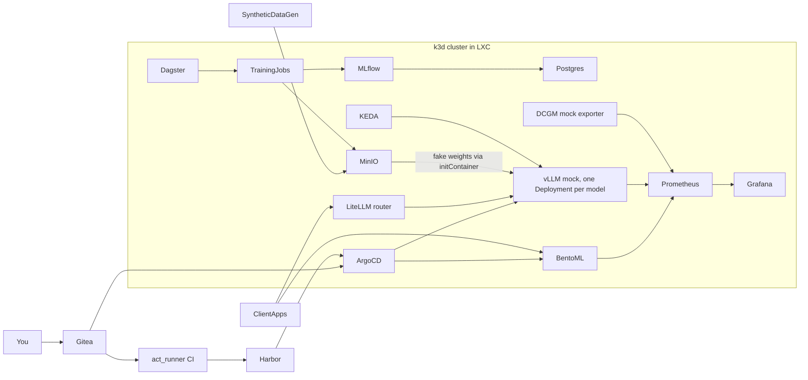

# On-prem MLOps, hands-on

You'll build this platform from an empty LXC, one component per module:



## How each module works

Every module page has the same six sections. Go through them in order:

| Section | What you do |
|---|---|
| **1. Problem to solve** | Read which gap in the pipeline the new tool closes. |
| **2. Foundations** | Learn the mental model and vocabulary. It's short; search the YouTube keywords for demos. |
| **3. Build it step by step** | Type or copy the code into your own folders, run it, and compare with *"You should see"*. |
| **4. Tweak and observe** | Change one thing, predict what happens, run it, compare. |
| **5. Break and fix** | Planted bugs in `exercises/mNN/`. Run `make check-mNN` until everything is green. |
| **6. Gotchas** | The short list worth remembering. |

!!! tip "Where things live"
    - `reference/mNN/` holds the verified solution for every file you build. The pages embed these files, so what you read is code that has actually run.
    - **Your** work goes into `src/`, `platform/` and `infra/`.
    - Stuck or short on time? `make catchup-mNN` copies the reference into your tree (backing up your files) and deploys it.

!!! info "Solutions are hidden"
    Hints and solutions are in collapsed boxes like this one. Try for a few minutes before opening them.

    ??? success "Solution (example)"
        Hidden until you click.

## Progress

- [ ] M0 Environment: tools, k3d cluster, this site
- [ ] M1 Kubernetes + Helm: MinIO (raw manifests), Postgres (your own Helm chart)
- [ ] M2 Synthetic data, DVC, DuckDB
- [ ] M3 MLflow tracking + registry
- [ ] M4 Dagster foundations (local)
- [ ] M5 Dagster on Kubernetes
- [ ] M6 BentoML serving
- [ ] M7 Gitea CI + Harbor
- [ ] M8 ArgoCD GitOps
- [ ] M9 LLM serving: vLLM mock + LiteLLM router
- [ ] M10 Prometheus, Grafana, KEDA
- [ ] M11 Capstone: drift to deploy, incident drill

## Daily commands

```bash
make docs            # this site
make cluster-start   # after an LXC reboot (state is kept)
make cluster-stop    # free RAM when you're done for the day
make urls            # list all web UIs
make help            # everything else
```
