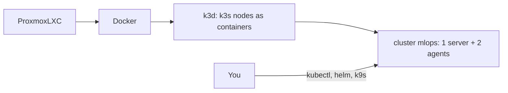

# M0: Environment bootstrap

## 1. Problem to solve

You have an empty Proxmox LXC with Docker. Every later module needs:

- a **Kubernetes cluster** you can create and destroy in seconds;
- the CLIs to talk to it (`kubectl`, `helm`, `k9s`) plus `dvc`;
- a Python project (uv, ruff, mypy, pytest) for the pipeline code.



## 2. Foundations

k3s
:   A lightweight but complete Kubernetes distribution. It ships as one binary and bundles containerd, CoreDNS, Traefik (ingress), local-path storage and metrics-server.

k3d
:   Runs k3s *inside Docker containers*. Each "node" is a container (`docker ps` shows them), and a small nginx `serverlb` container sits in front as the load balancer.

kubeconfig
:   `~/.kube/config` lists clusters, users and **contexts** (a cluster plus a user). `kubectl config current-context` tells you which cluster you're about to change. Check it before every destructive command.

Ingress + nip.io
:   An Ingress routes HTTP by hostname. `anything.<your-ip>.nip.io` is public DNS that always resolves to that IP. So you get real hostnames without editing `/etc/hosts`. In this course the placeholder `YOUR_SERVER_IP` stands for **this machine's LAN IP** (not a special “LXC” address — any host IP works).

**Why k3d inside an LXC is special.** You're running containers (k3s nodes) inside containers (Docker) inside a container (LXC). The kernel is shared with Proxmox, so anything that touches the kernel directly can be blocked by the LXC's policies: `/dev/kmsg`, sysctls, kernel modules. You'll meet this in Step 3.

!!! abstract "YouTube keywords"
    `k3d tutorial`, `k3s vs k3d vs kind`, `kubeconfig contexts explained`, `k9s tutorial`

## 3. Build it step by step

### Step 1: Check the host

```bash
systemd-detect-virt                 # -> lxc
cat /proc/self/uid_map              # "0 0 4294967295" = privileged LXC
cat /sys/fs/cgroup/cgroup.controllers   # cgroup v2 controllers (needs: cpu memory pids)
docker info | grep -E "Storage Driver|Cgroup"
free -h; nproc; df -h /
```

You should see `lxc`, a full `uid_map`, cgroup v2 and the `overlayfs` storage driver.

### Step 2: Install the CLIs

Everything goes to `~/.local/bin`, so no sudo is needed. The versions are pinned:

```bash title="scripts/install-tools.sh"
--8<-- "scripts/install-tools.sh"
```

```bash
scripts/install-tools.sh
```

### Step 3: The cluster definition

Copy the template into your tree and read every comment:

```bash
mkdir -p platform/k3d
cp reference/m00/platform/k3d/cluster.yaml.tpl platform/k3d/
```

```yaml title="platform/k3d/cluster.yaml.tpl"
--8<-- "reference/m00/platform/k3d/cluster.yaml.tpl"
```

!!! warning "The `/dev/kmsg` story (an LXC gotcha)"
    When this course was written, `/dev/kmsg` existed in the LXC, but **opening** it failed even for a `--privileged` container:

    ```text
    $ docker run --rm --privileged alpine head -c 10 /dev/kmsg
    head: /dev/kmsg: Operation not permitted
    ```

    Kubelet died with `failed to create kubelet: open /dev/kmsg: operation not permitted`, and `k3d cluster create` hung forever. In an LXC, *the device node existing* and *the cgroup allowing access to it* are two different things. The template binds `/dev/null` over it. The clean host-side fix is `lxc.cgroup2.devices.allow: c 1:11 rwm` in `/etc/pve/lxc/<id>.conf`.

### Step 4: Set your server IP

Manifests and examples use the placeholder `YOUR_SERVER_IP`. Replace it with
**this machine's LAN IP** (whatever host you run Docker on — laptop, VM, or
container):

```bash
hostname -I | awk '{print $1}'     # example: 10.0.0.42
make configure-ip                  # or: SERVER_IP=10.0.0.42 make configure-ip
cp -n .env.example .env            # then open .env if you need to adjust secrets
export SERVER_IP=$(hostname -I | awk '{print $1}')   # useful in every shell
```

In **every** new shell that runs course commands, load `.env` so tracking URIs
and S3 settings match the cluster (M3/M4 silent empty-UI failures often start here):

```bash
set -a && source .env && set +a
echo "$MLFLOW_TRACKING_URI"   # should be non-empty and use your LAN IP
```

`nip.io` turns `app.$SERVER_IP.nip.io` into DNS that resolves to that IP, so you
never edit `/etc/hosts`.

### Step 5: Create the cluster

```bash
make cluster-up      # renders the template with SERVER_IP, then k3d cluster create
kubectl config current-context    # -> k3d-mlops
kubectl get nodes -o wide
docker ps --format '{{.Names}}'   # the "nodes" are just containers
```

You should see three `Ready` nodes after about 25 seconds, and pods in `kube-system` becoming `Running` within about a minute.

### Step 6: Smoke-test ingress

```bash
kubectl create deploy whoami --image=traefik/whoami --port=80
kubectl expose deploy whoami --port=80
kubectl create ingress whoami --rule="whoami.$SERVER_IP.nip.io/*=whoami:80"
kubectl rollout status deploy/whoami
curl http://whoami.$SERVER_IP.nip.io:8080
```

You should see `Hostname: whoami-...`. The request went *host port 8080, then serverlb, then Traefik, then the Service, then the Pod*.

Clean up: `kubectl delete deploy,svc,ingress whoami`.

### Step 7: The Python project and this site

`pyproject.toml` is already in place:

- PyTorch is pulled from the **CPU-only** index (about 200 MB instead of about 2.5 GB of CUDA libraries).
- The dev tools (ruff, mypy, pytest, mkdocs-material) live in the `dev` group.

```bash
uv sync
make docs            # you're probably reading this through it already
make precommit       # ruff + mypy + pytest. Must be green before every commit
```

### Step 8: k9s tour

Run `k9s`, then try: `:pods` ++enter++, `0` (all namespaces), `/traefik` (filter), ++l++ (logs), ++d++ (describe), ++s++ (shell), `:nodes`, ++ctrl+c++. Keep k9s open in a second terminal for the rest of the course.

### Step 9: Commit a baseline

```bash
git add -A && git commit -m "m00: environment" && git tag m00-done
```

## 4. Tweak and observe

1. **Nodes are containers.** Run `docker stop k3d-mlops-agent-1`, then watch `kubectl get nodes -w`. How long until the node is `NotReady`? (About 40 s: the node lease timeout.) Then run `docker start k3d-mlops-agent-1`.
2. **Stop vs delete.** Run `make cluster-stop && make cluster-start`. The pods come back, so state survives. `make cluster-down` would delete everything.
3. **Inside a node.** Run `docker exec -it k3d-mlops-server-0 crictl ps`. These are the "real" containers that Kubernetes runs, managed by containerd inside the node container.
4. **Resource view.** Run `kubectl top nodes` and `docker stats --no-stream`. Compare what Kubernetes thinks each node uses with what Docker measures.

## 5. Break and fix

Each folder in `exercises/m00/` contains a broken `cluster.yaml.tpl`. Fix the file **in place**, then run:

```bash
make check-m00            # all bugs
make check-m00 BUG=bug02  # one bug
git checkout exercises/   # start over
```

**bug01-indentation.** Symptom: k3d accepts the file, but your kubelet eviction args are ignored and the context doesn't switch.

??? tip "Hint"
    YAML is indentation-sensitive. Which top-level keys does the checker expect? Run `python -c "import yaml,sys; print(yaml.safe_load(open(sys.argv[1])).keys())" exercises/m00/bug01-indentation/cluster.yaml.tpl`.

??? success "Solution"
    The `options:` block is indented two spaces, so it became part of the `registries` mapping. Move it back to column 0. k3d **silently ignores unknown nested keys**, which makes this kind of bug nasty.

**bug02-kmsg-agents.** Symptom: the server is `Ready`, but `k3d cluster create` hangs waiting for agents.

??? success "Solution"
    The `/dev/null:/dev/kmsg` volume only targets `server:*`. The agents run kubelet too, so the `nodeFilters` must be `[server:*, agent:*]`.

**bug03-ingress-port.** Symptom: `curl ...:8080` works at first, then fails after the server node restarts or when Traefik is scheduled on an agent.

??? success "Solution"
    Port 80 is mapped onto `server:0` instead of `loadbalancer`. The serverlb forwards to Traefik on *every* node; binding to a single node couples your entry point to that node.

## 6. Gotchas and best practices

- **Check your context** before `delete`: `kubectl config current-context`.
- **LXC kernel boundary:** `/dev/kmsg`, `sysctl` writes and `modprobe` warnings in k3s logs are normal in an LXC. Only `kubelet exited` is fatal.
- **Pin versions** (the k3s image and the CLIs). `latest` breaks courses and production alike.
- **Helm 4** is installed. Most blog posts show Helm 3. The core commands (`install`, `upgrade --install`, `template`) are the same, but plugins and some flags changed.
- **Docker disk hygiene:** k3d images, MLflow artifacts and Harbor blobs add up. Run `docker system df` weekly, and `docker image prune` to drop dangling images. The old stopped containers from earlier projects (mongo, rabbitmq, llm-emulator) can be removed with `docker container prune` when you no longer need them.
- **`k3d cluster stop`** frees RAM and keeps state. **`delete`** is a fresh start.
