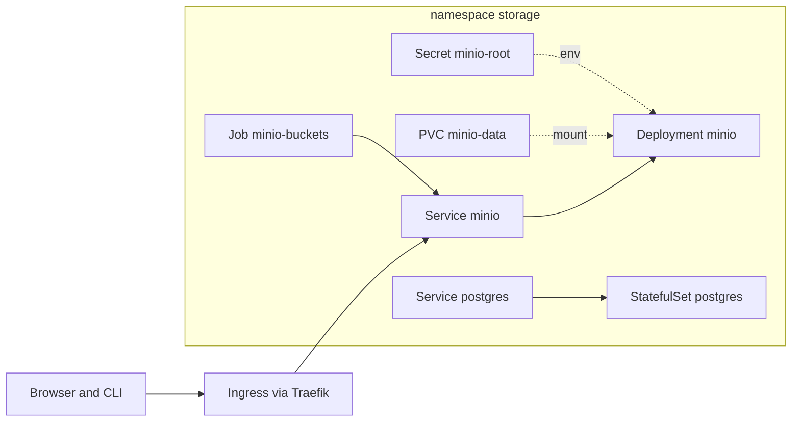

# M1: Kubernetes + Helm foundations

## 1. Problem to solve

Every later component needs two shared backing services:

- **object storage** (MinIO, S3-compatible) for datasets, DVC, MLflow artifacts and LLM weights;
- a **relational database** (Postgres) for MLflow's tracking store and Dagster's run storage.

They must survive restarts, be reachable by a stable name, and be described **as code**. That's exactly what Kubernetes objects are for. You'll deploy MinIO with hand-written manifests, so you see every object, and Postgres with a Helm chart **you write yourself**, so you learn templating from the inside.



## 2. Foundations

### The objects you'll use all course long

| Object | One-liner | You'll see it in |
|---|---|---|
| **Pod** | One or more containers sharing network and volumes. Mortal and replaceable. | everywhere |
| **Deployment** | Keeps N identical stateless pods running, and rolls out new versions. | MinIO, MLflow, BentoML, vLLM mock |
| **StatefulSet** | Like a Deployment, plus stable names and one volume per replica. | Postgres |
| **Service** | A stable virtual IP and DNS name in front of *ready* pods selected by labels. | everything |
| **Ingress** | HTTP routing by hostname or path from outside the cluster. | all web UIs |
| **ConfigMap / Secret** | Configuration and credentials injected as env vars or files. | everywhere |
| **PVC / PV / StorageClass** | "I need 20 Gi" / the actual disk / who creates it. | MinIO, Postgres |
| **Job / CronJob** | Run to completion, once or on a schedule. | bucket init, Dagster runs |
| **Namespace** | A folder for objects; the scope for names, RBAC and quotas. | one per component |

Labels and selectors
:   The glue of Kubernetes. A Service doesn't "point to a Deployment"; it selects *any ready pod whose labels match*. A typo in a label is a silent outage: no error, just zero endpoints.

Desired state and reconciliation
:   You `apply` *what you want*. Controllers loop forever making reality match it. A deleted pod gets recreated because the ReplicaSet controller notices that 0 is not 1.

Probes
:   **readiness** decides whether the pod receives traffic (it's removed from endpoints while failing). **liveness** decides whether the container is restarted. **startup** gives slow starters time before liveness kicks in (essential for vLLM in M9).

requests vs limits
:   The scheduler places pods by **requests**. **Limits** are enforced at runtime: going over the memory limit means `OOMKilled` (exit 137); going over the CPU limit means throttling.

### Helm in 5 sentences

A **chart** is a folder of templated YAML plus `values.yaml` defaults. `helm install/upgrade` renders the templates with your values and applies the result as a **release**, storing every revision as a Secret in the namespace. That's why `helm rollback` and `helm history` work. Templates use Go templating plus the Sprig functions: `{{ .Values.x }}`, `include`, `toYaml | nindent`, `quote`, `default`, `lookup`. **Always render before you apply**: `helm template` shows exactly what will hit the cluster.

!!! abstract "YouTube keywords"
    `kubernetes explained pods deployments services`, `kubernetes probes readiness liveness`, `kubernetes requests vs limits OOMKilled`, `helm chart from scratch`, `helm templating tutorial`

## 3. Build it step by step

### Part A: MinIO with raw manifests

Create `platform/k8s/storage/` and write the files one by one. Read each comment and type it rather than copying. The numeric prefixes make `kubectl apply -f dir/` apply them in order.

=== "00-namespace.yaml"

    ```yaml
    --8<-- "reference/m01/platform/k8s/storage/00-namespace.yaml"
    ```

=== "10-minio-secret.yaml"

    ```yaml
    --8<-- "reference/m01/platform/k8s/storage/10-minio-secret.yaml"
    ```

=== "20-minio-pvc.yaml"

    ```yaml
    --8<-- "reference/m01/platform/k8s/storage/20-minio-pvc.yaml"
    ```

=== "30-minio-deployment.yaml"

    ```yaml
    --8<-- "reference/m01/platform/k8s/storage/30-minio-deployment.yaml"
    ```

=== "40-minio-service.yaml"

    ```yaml
    --8<-- "reference/m01/platform/k8s/storage/40-minio-service.yaml"
    ```

=== "50-minio-ingress.yaml"

    ```yaml
    --8<-- "reference/m01/platform/k8s/storage/50-minio-ingress.yaml"
    ```

=== "60-minio-buckets-job.yaml"

    ```yaml
    --8<-- "reference/m01/platform/k8s/storage/60-minio-buckets-job.yaml"
    ```

!!! warning "MinIO images in 2026"
    MinIO stopped publishing community Docker images in late 2025: `minio/minio` and `quay.io/minio/minio` no longer pull. This course uses Chainguard's free source build `cgr.dev/chainguard/minio`, pinned by digest. Their `mc` image is **distroless** (no shell), which is why the Job calls `mc` directly.

Apply the manifests and watch:

```bash
kubectl apply -f platform/k8s/storage/
kubectl -n storage get pods -w                  # Ctrl+C once minio is 1/1 Running
kubectl -n storage logs job/minio-buckets       # "Bucket created successfully" x5
kubectl -n storage get pvc,pv                   # STATUS Bound
kubectl -n storage get endpointslices           # the pod IP behind Service minio
```

You should see:

- `curl -s -o /dev/null -w '%{http_code}' http://s3.$SERVER_IP.nip.io:8080/minio/health/ready` returns `200`;
- the console at `http://minio.<LXC-IP>.nip.io:8080` (log in with `mlops` / `mlops-minio-secret`) lists 5 buckets.

### Part B: Postgres with your own Helm chart

Scaffold the folder `platform/charts/postgres/` and write these files:

=== "Chart.yaml"

    ```yaml
    --8<-- "reference/m01/platform/charts/postgres/Chart.yaml"
    ```

=== "values.yaml"

    ```yaml
    --8<-- "reference/m01/platform/charts/postgres/values.yaml"
    ```

=== "templates/_helpers.tpl"

    ```go-html-template
    --8<-- "reference/m01/platform/charts/postgres/templates/_helpers.tpl"
    ```

=== "templates/secret.yaml"

    ```yaml
    --8<-- "reference/m01/platform/charts/postgres/templates/secret.yaml"
    ```

=== "templates/configmap-initdb.yaml"

    ```yaml
    --8<-- "reference/m01/platform/charts/postgres/templates/configmap-initdb.yaml"
    ```

=== "templates/statefulset.yaml"

    ```yaml
    --8<-- "reference/m01/platform/charts/postgres/templates/statefulset.yaml"
    ```

=== "templates/service.yaml"

    ```yaml
    --8<-- "reference/m01/platform/charts/postgres/templates/service.yaml"
    ```

=== "templates/NOTES.txt"

    ```text
    --8<-- "reference/m01/platform/charts/postgres/templates/NOTES.txt"
    ```

The lab overrides live outside the chart, in `platform/helm-values/postgres.yaml`:

```yaml title="platform/helm-values/postgres.yaml"
--8<-- "reference/m01/platform/helm-values/postgres.yaml"
```

Render, lint and install:

```bash
helm lint platform/charts/postgres -f platform/helm-values/postgres.yaml
helm template postgres platform/charts/postgres -n storage \
  -f platform/helm-values/postgres.yaml | less          # READ what you're about to apply
helm upgrade --install postgres platform/charts/postgres -n storage \
  -f platform/helm-values/postgres.yaml --wait          # idempotent: install OR upgrade
helm list -n storage
kubectl -n storage exec -it postgres-0 -- psql -U mlops -d postgres -c '\l'
```

You should see the databases `mlflow`, `dagster` and `litellm` owned by `mlops`.

!!! tip "`upgrade --install` everywhere"
    `helm install` fails if the release exists, and `helm upgrade` fails if it doesn't. `upgrade --install` always works, which is what scripts and CI should use.

### Commit

```bash
git add platform/ && git commit -m "m01: minio + postgres" && git tag m01-done
```

## 4. Tweak and observe

1. **Self-healing.** Run `kubectl -n storage delete pod -l app.kubernetes.io/name=minio` and watch `get pods -w`. A new pod with a new name appears. Are your buckets still there? (Yes: the PVC survived.)
2. **Statefulness.** Run `kubectl -n storage delete pod postgres-0`. The replacement is named `postgres-0` again and re-mounts `data-postgres-0`.
3. **Readiness in action.** Chainguard/distroless MinIO has no process-signal tools (or shell) in `$PATH`, so do **not** `kubectl exec` a kill into the container. Instead run `kubectl -n storage rollout restart deploy/minio` while watching `kubectl -n storage get endpointslices -w`. The pod IP disappears from the endpoints until the new pod is Ready.
4. **Helm history.** Change `config.max_connections` to `"300"` in your values, `helm upgrade` it, then run `helm history postgres -n storage`, then `helm rollback postgres 1 -n storage`. Check the setting with `psql -c 'show max_connections'`.
5. **Checksum annotation.** Add a database to `databases:` and upgrade. The pod restarts because the initdb checksum changed, **but the database is not created**. Why? (The init scripts only run on an empty data dir.) Create it by hand: `psql -c 'CREATE DATABASE x OWNER mlops'`.
6. **Scheduling.** Run `kubectl -n storage get pods -o wide`. Which node is MinIO on? Run `kubectl get pv -o yaml | grep -A3 nodeAffinity`. local-path pins the volume, and therefore the pod, to that node.

## 5. Break and fix

Each folder in `exercises/m01/` deploys into its own throw-away namespace `ex-m01-bugNN` and deletes it afterwards.

```bash
make check-m01             # all six (about 4 min)
make check-m01 BUG=bug02   # one
```

**bug01-service-selector.** Symptom: the pod is `1/1 Running`, but `curl minio:9000` from inside the cluster times out.

??? tip "Hint"
    `kubectl get endpointslices` for the Service. How many endpoints are there? Compare `kubectl get pods --show-labels` with the Service's `spec.selector`.

??? success "Solution"
    The Service selects `app: minio`, but the pods carry `app.kubernetes.io/name: minio`. A selector that matches nothing is valid YAML, so Kubernetes gives no error and simply no endpoints.

**bug02-target-port.** Symptom: the endpoints exist, but connections are refused.

??? success "Solution"
    `targetPort: 9090`: nothing listens there. Use the **named** port `s3`. Named ports keep working if the container port ever changes.

**bug03-oomkilled.** Symptom: `CrashLoopBackOff`, and the restart count climbs.

??? tip "Hint"
    `kubectl describe pod` shows `Last State: Terminated, Reason: OOMKilled, Exit Code: 137`.

??? success "Solution"
    A memory limit of 24Mi is far too small for MinIO. Set the request to `128Mi` and the limit to `512Mi`. Also note what the API server enforces: `requests` must be at most `limits`.

**bug04-secret-key.** Symptom: the pod is stuck in `CreateContainerConfigError`.

??? success "Solution"
    `secretKeyRef.key: password` doesn't exist in the Secret (the key is `MINIO_ROOT_PASSWORD`). `kubectl describe pod` says `couldn't find key password in Secret`.

**bug05-helm-types.** Symptom: `helm template` works, but applying fails with `cannot unmarshal number into Go struct field ... of type string`.

??? tip "Hint"
    There are two bugs. Label values and env values must be **strings**. And what is `17.10` in YAML?

??? success "Solution"
    Use `{{ .Values.maxConnections | quote }}` for the env var, and `{{ .Values.image.majorMinor | quote }}` for the label, *plus* quote `"17.10"` in values.yaml. Unquoted, it's the float `17.1`, and quoting it in the template would only produce `"17.1"`.

**bug06-helm-password.** Symptom: after every `helm upgrade`, all database clients fail authentication.

??? success "Solution"
    `randAlphaNum` runs on every render, so each upgrade generates a new password. Use `lookup` to reuse the existing Secret (exactly what your Postgres chart's `secret.yaml` does), and only generate on the very first install.

## 6. Gotchas and best practices

- `kubectl apply -f dir/` applies files in **alphabetical order**: prefix them (`00-`, `10-`) when order matters.
- **RWO volume + Deployment** means using `strategy: Recreate`, or the new pod can hang waiting for the volume. A StatefulSet handles this for you.
- **Jobs are immutable.** To re-run one, `kubectl delete job X` and then apply again.
- **Selector labels are immutable** on Deployments and StatefulSets. Choose them once (`app.kubernetes.io/name` + `instance`) and never put the version in them.
- **Quote everything** that must be a string in Helm templates: env values, labels, annotations, version-like numbers.
- **Never apply what you haven't rendered:** `helm template ... | less`, or `helm diff` (plugin) on upgrades.
- **Base64 is not encryption.** A Secret in git is a credential leak outside of labs.
- Debug flow for "it doesn't work": `get pods`, then `describe pod` (look at Events at the bottom), then `logs` (and `logs --previous` after a crash), then `get endpointslices`, then curl from inside with `kubectl run curl --rm -it --image=curlimages/curl -- sh`.
