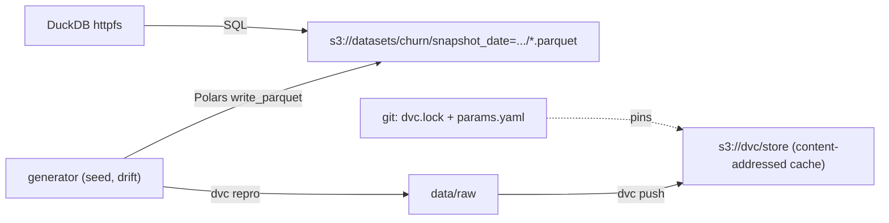

# M2: Synthetic data, DVC and DuckDB

## 1. Problem to solve

A model is only reproducible if you can answer *"which exact data was it trained on?"* months later. Right now you have nothing to train on at all. This module:

1. **generates** realistic, reproducible data: a customer churn table with daily snapshots, plus support tickets for the LLM part;
2. **stores** it in MinIO as Hive-partitioned Parquet: the "data lake" that pipelines read;
3. **versions** it with DVC, so a git commit pins the exact data bytes;
4. **queries** it in place with DuckDB, with no database server.



## 2. Foundations

Synthetic data with a known truth
:   The generator *is* the ground-truth model. You know that tickets drive churn, so you can check that the model finds it. You can also inject **drift** on purpose: **covariate drift** (inputs shift) and **concept drift** (the input-to-label relationship changes; here, the discount effect flips).

Parquet + Hive partitioning
:   A columnar, compressed, typed file format. Folders like `snapshot_date=2026-10-01/` turn a column into a directory, so engines skip whole folders when you filter on that column (**partition pruning**).

DVC
:   *Git for data*. Git stores small pointer files (`data/raw.dvc` or `dvc.lock`) containing **hashes**. DVC stores the bytes in a **cache** (`.dvc/cache`) and a **remote** (MinIO). `git checkout <old commit> && dvc checkout` restores the exact old data.

DVC pipeline
:   `dvc.yaml` declares stages with `deps`, `params` and `outs`. `dvc repro` re-runs only the stages whose inputs changed, with dependency tracking like `make`, but based on hashes rather than timestamps.

The DVC remote is not a data lake
:   Files in `s3://dvc/store` are named by hash (`files/md5/ab/cdef...`), so you can't query them. That's why the data is written **twice**: to the lake for consumption, and DVC-tracked for reproducibility. In M4, Dagster becomes the main writer to the lake.

DuckDB
:   An in-process analytical SQL engine (think "SQLite for analytics"). With the `httpfs` extension it reads `s3://` Parquet directly. Perfect for ad-hoc exploration and for feature SQL inside pipeline steps.

!!! abstract "YouTube keywords"
    `DVC tutorial data version control`, `dvc pipelines dvc repro`, `parquet hive partitioning explained`, `duckdb s3 parquet`, `polars vs pandas`, `data drift vs concept drift`

## 3. Build it step by step

### Step 1: Dependencies and credentials

```bash
uv add numpy polars duckdb pydantic pydantic-settings pyyaml
cp .env.example .env          # S3 endpoint + MinIO credentials; .env is git-ignored
```

```bash title=".env.example"
--8<-- ".env.example"
```

### Step 2: Tests first

Write the tests **before** the generator. They are the specification: determinism, schema, a plausible label and drift behaviour.

```python title="tests/test_data_generator.py"
--8<-- "reference/m02/tests/test_data_generator.py"
```

`uv run pytest` fails now (with an `ImportError`). That's the point.

### Step 3: The generator package

Create `src/mlops_course/data/` with these files:

=== "config.py"

    ```python
    --8<-- "reference/m02/src/mlops_course/data/config.py"
    ```

=== "churn.py"

    ```python
    --8<-- "reference/m02/src/mlops_course/data/churn.py"
    ```

=== "tickets.py"

    ```python
    --8<-- "reference/m02/src/mlops_course/data/tickets.py"
    ```

=== "storage.py"

    ```python
    --8<-- "reference/m02/src/mlops_course/data/storage.py"
    ```

=== "cli.py"

    ```python
    --8<-- "reference/m02/src/mlops_course/data/cli.py"
    ```

=== "\_\_init\_\_.py"

    ```python
    --8<-- "reference/m02/src/mlops_course/data/__init__.py"
    ```

```bash
uv run pytest -q          # 8 passed
make precommit            # ruff + mypy + pytest
```

### Step 4: Write to the lake and query it with DuckDB

```bash
uv run python -m mlops_course.data.cli --out s3://datasets --days 3
```

Open the MinIO console, then the `datasets` bucket, then `churn/`. You should see three `snapshot_date=...` folders.

Now query them without downloading anything:

```python
uv run python
>>> from mlops_course.data.config import S3Settings
>>> from mlops_course.data.storage import duckdb_s3
>>> with duckdb_s3(S3Settings()) as con:
...     print(con.sql("""
...         SELECT snapshot_date, count(*) n, round(avg(churned), 3) churn_rate
...         FROM read_parquet('s3://datasets/churn/*/*.parquet', hive_partitioning = true)
...         GROUP BY ALL ORDER BY 1"""))
...     print(con.sql("SELECT plan, round(avg(churned),3) FROM 's3://datasets/churn/*/*.parquet' GROUP BY 1"))
```

You should see three days with about 10,000 rows each and a churn rate of about 0.13. `basic` churns more than `pro`, as the generator intends.

### Step 5: DVC

```bash
dvc init                                    # creates .dvc/ (commit it) and .dvcignore
dvc remote add -d minio s3://dvc/store      # -d = default remote
dvc remote modify minio endpointurl http://s3.$LXC_IP.nip.io:8080
dvc remote modify --local minio access_key_id mlops                  # --local -> .dvc/config.local
dvc remote modify --local minio secret_access_key mlops-minio-secret #   which is git-ignored
cat .dvc/config            # no secrets in here
```

Add these lines to `.dvcignore`:

```text title=".dvcignore (append)"
--8<-- "reference/m02/.dvcignore"
```

Create the parameters and the pipeline:

=== "params.yaml"

    ```yaml
    --8<-- "reference/m02/params.yaml"
    ```

=== "dvc.yaml"

    ```yaml
    --8<-- "reference/m02/dvc.yaml"
    ```

```bash
dvc repro                  # runs `generate`, writes dvc.lock
dvc repro                  # "Stage 'generate' didn't change, skipping"
dvc push                   # uploads data/raw to s3://dvc/store
git add dvc.yaml dvc.lock params.yaml .dvc/config .dvcignore data/.gitignore
git commit -m "m02: data v1 (drift 0.0)" && git tag m02-done
```

!!! info "What git now contains"
    `dvc.lock` holds the md5 of `data/raw` and of every input. That small text file *is* the dataset version. Look at it: `cat dvc.lock`.

## 4. Tweak and observe

1. **Time travel.** Set `drift: 0.6` in `params.yaml`, then `dvc repro && dvc push && git commit -am "data v2"`. Run `git log --oneline`, then `git checkout HEAD~1 -- dvc.lock params.yaml && dvc checkout`. `data/raw` is back to v1. Run `git checkout HEAD -- . && dvc checkout` to return.
2. **What triggers a re-run?** Edit a comment in `churn.py` and run `dvc status`. The code dependency changed, so the stage is "changed". Now delete `__pycache__/` from `.dvcignore` and run `python -c "import mlops_course.data.churn"`. Why does `dvc status` flip?
3. **Partition pruning.** In DuckDB, run `EXPLAIN ANALYZE SELECT count(*) FROM read_parquet('s3://datasets/churn/*/*.parquet', hive_partitioning=true) WHERE snapshot_date = '2026-10-02'`. How many files were read?
4. **Look inside the DVC remote.** In the MinIO console, open `dvc/store/files/md5/...`. The names are hashes, and that's why you can't query it.
5. **Drift you can see.** Generate with `--drift 1.0 --out s3://datasets/drifted --days 1` and compare `avg(monthly_spend)` and `avg(support_tickets_90d)` with the baseline.

## 5. Break and fix

These checks need the MinIO from M1 and the data from Step 4.

```bash
make check-m02
```

**bug01-reproducibility.** Symptom: `dvc repro --force` produces a new `dvc.lock` hash even though nothing changed.

??? success "Solution"
    `promo_rng = np.random.default_rng()` has **no seed**, so it draws fresh OS entropy on every run. Every random draw must come from the single seeded `rng` (or from a child generator seeded from it).

**bug02-duckdb-s3.** Symptom: `IO Error: Could not resolve hostname datasets.s3...` (or an HTTP 403/404).

??? success "Solution"
    `URL_STYLE 'path'` is missing. DuckDB defaults to *virtual-hosted* style (`bucket.host`), which is AWS's style. MinIO behind a single hostname needs `http://host/bucket/key`.

**bug03-settings-prefix.** Symptom: `PermissionError ... lacked the necessary privileges`, even though `.env` contains the right password.

??? tip "Hint"
    `python -c "from config import S3Settings; print(S3Settings())"` (run in the bug folder). Is `secret_key` filled?

??? success "Solution"
    `env_prefix="S3"` makes pydantic-settings look for `S3SECRET_KEY`. The prefix must be `S3_`. Settings that silently fall back to defaults are a classic production incident. Consider making secrets required (no default), so that a missing value fails at startup.

**bug04-partitions.** Symptom: `daily_churn()` raises `No files found`, or returns rows without `snapshot_date`.

??? success "Solution"
    Two issues. The glob `churn/*.parquet` doesn't descend into the `snapshot_date=...` folders: use `churn/*/*.parquet` (or `churn/**/*.parquet`). And the partition column only exists in the **path**, so pass `hive_partitioning = true` to turn it back into a column.

**bug05-dvc-secrets.** Symptom: a teammate (or a CI log) can read the MinIO password from `.dvc/config`.

??? success "Solution"
    Move `access_key_id` and `secret_access_key` into `config.local` (written by `dvc remote modify --local`). Keep `url` and `endpointurl` in the shared config. If the secret was ever committed, **rotate it**: removing it from the latest commit doesn't remove it from git history.

## 6. Gotchas and best practices

- **One seeded `np.random.default_rng(seed)` per process.** Never use the `np.random.*` globals.
- **`dvc.lock` is the dataset version: commit it.** `data/raw` itself is git-ignored (DVC writes `data/.gitignore`).
- **Ignore `__pycache__`** in `.dvcignore` when a stage depends on a code directory.
- **The DVC remote is a cache, not a lake.** Consumers read the lake (Hive Parquet), not DVC.
- **S3 on MinIO** means a path-style URL, an explicit endpoint, and a region set to anything (`us-east-1`).
- **DuckDB `httpfs`** downloads on first use. In an air-gapped site, pre-install the extension or set `extension_directory`.
- **Polars `partition_by`** is still marked unstable. Pin your Polars version, and remember that Polars 2.0 changed several APIs.
- **Pydantic for configs:** fail fast at load time, not 40 minutes into a training job.
