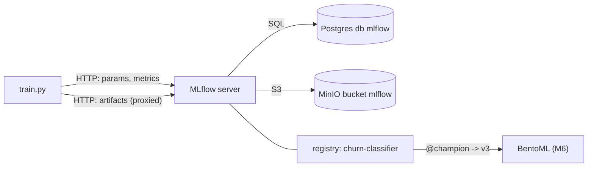

# M3: MLflow tracking and registry

## 1. Problem to solve

You can generate data, but training runs would live only in your terminal: no record of hyper-parameters, no comparison between runs, no single place where "the production model" is defined. MLflow gives you:

- **Tracking:** every run's params, metrics (with curves), tags and artifacts, kept in Postgres and MinIO;
- **Models:** a standard packaging format (`pyfunc`) that bundles code, weights, preprocessing and a signature;
- **Registry:** named models with versions and **aliases** (`@champion`, `@challenger`) that deployments refer to.



## 2. Foundations

Run, experiment
:   A **run** is one execution: params (inputs), metrics (numbers, optionally per `step`), tags (free-form metadata) and artifacts (files). An **experiment** groups runs that can be compared, for example `churn`.

Backend store vs artifact store
:   Metadata (small, queryable) goes to the **backend store** (Postgres). Files (large) go to the **artifact store** (MinIO).

Proxied artifacts (`--serve-artifacts`)
:   Clients upload and download artifacts **through the MLflow server**. Only the server needs S3 credentials. The alternative (`--no-serve-artifacts`) makes every client talk to S3 directly, so every laptop, CI job and pod needs credentials and the endpoint.

pyfunc
:   MLflow's generic model interface: `predict(DataFrame) -> DataFrame`. You'll write a custom `PythonModel` that takes **raw columns** and applies the exact same feature code and frozen scaler as training. That removes training/serving skew by construction.

Signature
:   The declared input/output schema, inferred from an example. Serving validates requests against it.

Aliases (not stages)
:   *Staging/Production* stages are deprecated. An alias is a movable pointer: `models:/churn-classifier@champion`. Promotion and rollback mean moving the pointer; the deployment keeps loading `@champion`.

Champion/challenger
:   New models become `@challenger`. Promote only if the challenger beats the champion **on the same fresh holdout data**.

!!! abstract "YouTube keywords"
    `mlflow tracking server postgres s3`, `mlflow model registry aliases`, `mlflow pyfunc custom model`, `training serving skew`, `champion challenger model deployment`

## 3. Build it step by step

### Step 1: The server image

The official image has no Postgres driver. Extend it:

```dockerfile title="platform/images/mlflow/Dockerfile"
--8<-- "reference/m03/platform/images/mlflow/Dockerfile"
```

```bash
docker build -t mlops/mlflow:3.17.1-2 platform/images/mlflow
k3d image import mlops/mlflow:3.17.1-2 -c mlops     # copies the image into every k3d node
docker exec k3d-mlops-agent-0 crictl images | grep mlflow
```

!!! info "Why `k3d image import`?"
    The k3d nodes run their **own containerd**. They can't see images in your LXC's Docker. Until Harbor arrives in M7, `k3d image import` copies the image tarball into every node. Tag images with an explicit version (`3.17.1-2`, not `latest`) and set `imagePullPolicy: IfNotPresent`, or the kubelet will try to pull from Docker Hub.

### Step 2: Deploy the server

Create `platform/k8s/mlflow/`:

=== "00-namespace.yaml"

    ```yaml
    --8<-- "reference/m03/platform/k8s/mlflow/00-namespace.yaml"
    ```

=== "10-secret.yaml"

    ```yaml
    --8<-- "reference/m03/platform/k8s/mlflow/10-secret.yaml"
    ```

=== "20-deployment.yaml"

    ```yaml
    --8<-- "reference/m03/platform/k8s/mlflow/20-deployment.yaml"
    ```

=== "30-service-ingress.yaml"

    ```yaml
    --8<-- "reference/m03/platform/k8s/mlflow/30-service-ingress.yaml"
    ```

```bash
kubectl apply -f platform/k8s/mlflow/
kubectl -n mlflow rollout status deploy/mlflow
kubectl -n mlflow logs deploy/mlflow | head -30      # watch the DB migrations on first start
```

You should see `curl http://mlflow.$SERVER_IP.nip.io:8080/health` return `OK`, and the UI open in your browser.

!!! bug "Two real errors hit while writing this module"
    1. `ModuleNotFoundError: No module named 'psycopg'`. **SQLAlchemy 2.1** maps `postgresql://` to *psycopg 3*, not psycopg2, so the plain URI picks a driver you didn't install. The fix is to install `psycopg` **and** spell the driver out: `postgresql+psycopg://`.
    2. `model loading hangs forever` from the host. The server advertises *multipart downloads*: it hands the client presigned MinIO URLs built from **its own** endpoint (`minio.storage.svc.cluster.local`), which doesn't resolve outside the cluster. Clients outside Kubernetes set `MLFLOW_ENABLE_PROXY_MULTIPART_DOWNLOAD=false` (and the `_UPLOAD` equivalent) to stream through the server instead. They're in `.env.example`.

### Step 3: Client environment

```bash
uv add "mlflow==3.17.1" torch scikit-learn pandas     # torch comes from the CPU index (pyproject)
cp .env.example .env && set -a && source .env && set +a   # MLFLOW_TRACKING_URI etc.
```

```bash title=".env.example"
--8<-- ".env.example"
```

### Step 4: Tests first

```python title="tests/test_training.py"
--8<-- "reference/m03/tests/test_training.py"
```

### Step 5: Training code

Create `src/mlops_course/training/`:

=== "features.py"

    ```python
    --8<-- "reference/m03/src/mlops_course/training/features.py"
    ```

=== "model.py"

    ```python
    --8<-- "reference/m03/src/mlops_course/training/model.py"
    ```

=== "train.py"

    ```python
    --8<-- "reference/m03/src/mlops_course/training/train.py"
    ```

=== "registry.py"

    ```python
    --8<-- "reference/m03/src/mlops_course/training/registry.py"
    ```

```bash
uv run pytest -q                                            # 13 passed (uses a temp SQLite MLflow)
uv run python -m mlops_course.training.train --model logreg
uv run python -m mlops_course.training.train --model mlp --epochs 30
```

In the UI, open **Experiments**, then **churn**, select both runs and click **Compare**. Look at `val_auc_epoch` as a curve, the params side by side, and the run's **Artifacts** tab (`code/`, `artifacts/weights.*`, `scaler.json`, `MLmodel`).

### Step 6: Registry and promotion

```bash
uv run python -m mlops_course.training.registry register --run-id <logreg run id>
uv run python -m mlops_course.training.registry promote      # no champion yet -> promoted
uv run python -m mlops_course.training.registry register --run-id <mlp run id>
uv run python -m mlops_course.training.registry promote      # promoted only if better
uv run python -m mlops_course.training.registry show
```

Then load the model the way the serving layer will:

```python
import mlflow, polars as pl
model = mlflow.pyfunc.load_model("models:/churn-classifier@champion")
model.predict(pl.read_parquet("data/raw/churn/*/*.parquet").head(3).to_pandas())
```

```bash
git add platform src tests && git commit -m "m03: mlflow" && git tag m03-done
```

## 4. Tweak and observe

1. **Curves need steps.** In `_fit_mlp`, remove `step=epoch` and train. What does the `train_loss` chart look like now?
2. **Lineage.** Run `dvc repro` after changing `drift`, then train again. Compare the `data_version` param of the two runs. This is how you answer "which data was this model trained on?".
3. **Rollback.** In the UI (**Models**, then **churn-classifier**), move `@champion` back to version 1. Anything loading `@champion` now gets v1, and nothing was redeployed.
4. **Where do the bytes live?** Open the MinIO console at `mlflow/1/models/m-.../artifacts`. Then run `kubectl -n storage exec postgres-0 -- psql -U mlops -d mlflow -c 'select name, version, source from model_versions'`.
5. **Signature enforcement.** Call `model.predict(df.drop("plan"))`. MLflow refuses before your code even runs.
6. **Scale the server.** Run `kubectl -n mlflow scale deploy/mlflow --replicas=2`. Why is that safe here? (The server is stateless; all state is in Postgres and MinIO.)

## 5. Break and fix

bug01 to bug03 deploy a small MLflow server per exercise (SQLite backend, real MinIO). bug04 and bug05 are pure Python.

```bash
make check-m03
```

**bug01-s3-endpoint.** Symptom: the client gets HTTP 500s and `Max retries exceeded` on artifact upload. The server log shows boto3 errors against `amazonaws.com`.

??? success "Solution"
    `MLFLOW_S3_ENDPOINT_URL` is missing, so boto3 defaults to **real AWS S3**. Every S3 client in an on-prem setup needs the endpoint set explicitly (boto3, Polars, DuckDB, DVC: each with its own setting name).

**bug02-allowed-hosts.** Symptom: in-cluster clients work, but the UI and API through the Ingress return `403 Invalid Host header - possible DNS rebinding attack detected`.

??? success "Solution"
    MLflow 3's security middleware only accepts `Host` headers in `--allowed-hosts`. The Ingress hostname **including `:8080`** must be listed. Avoid `--allowed-hosts '*'` outside labs.

**bug03-artifact-mode.** Symptom: `botocore.exceptions.NoCredentialsError: Unable to locate credentials` **on the client**.

??? tip "Hint"
    Where does the client send artifacts? Look at the experiment's `artifact_location`: `s3://...` or `mlflow-artifacts:/...`?

??? success "Solution"
    `--default-artifact-root s3://... --no-serve-artifacts` means clients write to S3 *themselves*. Switch to `--artifacts-destination s3://... --serve-artifacts`. Note that existing experiments keep their old `artifact_location`, so create a new experiment after switching modes.

**bug04-metric-steps.** Symptom: the loss chart shows a single dot or a vertical line instead of a curve.

??? success "Solution"
    `log_metric("train_loss", loss)` without `step=` logs every value at step 0. Pass `step=epoch`.

**bug05-eval-mode.** Symptom: the same customer gets a different churn probability on every request.

??? success "Solution"
    `self.model.eval()` is missing in `load_context`, so **dropout stays active at inference**. Also wrap inference in `torch.no_grad()`, which saves memory and time.

## 6. Gotchas and best practices

- **Explicit DB driver:** `postgresql+psycopg://` (SQLAlchemy 2.1 picks psycopg 3 for plain `postgresql://`).
- **Proxied artifacts** (`--serve-artifacts`): only the server holds S3 credentials.
- **Clients outside the cluster:** `MLFLOW_ENABLE_PROXY_MULTIPART_DOWNLOAD=false` / `_UPLOAD=false`, or the presigned URLs point at in-cluster DNS.
- **`--allowed-hosts`** must contain every `host:port` that clients use.
- **Aliases, not stages:** deploy `@champion`, and promote and roll back by moving the alias.
- **Ship preprocessing inside the model** (pyfunc with artifacts), and fit scalers on **train only**.
- **`model.eval()` + `torch.no_grad()`** at inference, every time.
- **Always pass `step=`** for per-epoch metrics.
- **Compare challenger vs champion on the same fresh data**, never their logged metrics from different splits.
- **The first start runs DB migrations.** Use a `startupProbe` so liveness doesn't kill the pod mid-migration. Upgrading MLflow also migrates the schema, so back up Postgres first.
