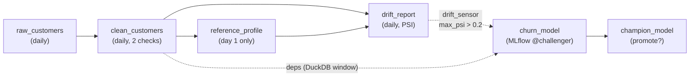

# M4: Dagster foundations (local)

## 1. Problem to solve

So far every step is a command you run by hand: generate data, train, register, promote. In production you need:

- data that arrives **every day** and is processed **per day**;
- quality checks that **stop** bad data before it reaches training;
- **drift detection** that triggers retraining automatically;
- one UI showing what exists, how fresh it is, and what produced it.

Dagster is an orchestrator built around **assets**: you declare *what data should exist* and how it's computed from other assets. Dagster derives the graph, runs it, and keeps a history of every materialization.



In this module everything runs **locally** (`dagster dev`) against the real MinIO and MLflow. M5 moves the same code into Kubernetes.

## 2. Foundations

If you know GitLab CI: a pipeline is *tasks in order*. Dagster flips it around: you describe **data products**, and the order follows from their dependencies.

Asset
:   A function decorated with `@dg.asset` that produces a persistent object (a Parquet table, a model). Its **parameters name its upstream assets**: `def clean_customers(raw_customers)` means "clean depends on raw". Running it is a **materialization**.

IO manager
:   Decides *where and how* an asset's return value is stored, and how it's loaded for downstream assets. Asset code just returns a DataFrame; the IO manager writes `s3://dagster/<asset>/<partition>.parquet`. Swap the IO manager and the same code writes to a local folder in tests.

Resource
:   A configured external dependency (S3 credentials, MLflow URI) **injected** into assets by parameter name. It's dependency injection: assets never read env vars themselves.

Partitions
:   An asset can be split into slices, here one per day. You materialize, backfill and inspect each day independently. A partitioned downstream automatically reads the **same** partition upstream.

Asset checks
:   Data-quality tests attached to an asset (`schema_matches`, `churn_rate_plausible`). They show up green or red in the UI. A `blocking` check stops downstream assets from running.

Jobs, schedules, sensors
:   A **job** is a selection of assets to run together. A **schedule** runs a job at a fixed time. A **sensor** is a function evaluated every N seconds that decides whether to launch runs, for example "a new drift report shows drift". A sensor stores a **cursor** so each event is handled once.

Definitions
:   The single object (`defs`) that Dagster loads: all assets, jobs, schedules, sensors and resources. If it doesn't load, nothing runs, and the UI shows the error.

Daemon
:   The background process that evaluates schedules and sensors and launches queued runs. `dagster dev` starts the webserver **and** the daemon.

!!! abstract "YouTube keywords"
    `dagster software defined assets`, `dagster io manager`, `dagster partitions backfill`, `dagster asset checks`, `dagster sensors cursor`, `population stability index drift`

## 3. Build it step by step

### Step 1: Install

```bash
uv add dagster==1.13.26 dagster-webserver==1.13.26
mkdir -p src/mlops_course/pipelines && touch src/mlops_course/pipelines/__init__.py
```

### Step 2: Tests first

The tests use a **local** lake in `tmp_path` and a SQLite MLflow, so they run in seconds without the cluster. That's the payoff of injecting resources.

```python title="tests/test_pipelines.py"
--8<-- "reference/m04/tests/test_pipelines.py"
```

### Step 3: Resources and the IO manager

=== "resources.py"

    ```python
    --8<-- "reference/m04/src/mlops_course/pipelines/resources.py"
    ```

=== "io_managers.py"

    ```python
    --8<-- "reference/m04/src/mlops_course/pipelines/io_managers.py"
    ```

=== "partitions.py"

    ```python
    --8<-- "reference/m04/src/mlops_course/pipelines/partitions.py"
    ```

The `Lake` resource does two jobs. The IO manager uses it for per-partition files, and assets that need **a range of days** query it with DuckDB (`lake.sql(...)`).

### Step 4: Ingest and monitoring assets

```python title="src/mlops_course/pipelines/assets.py"
--8<-- "reference/m04/src/mlops_course/pipelines/assets.py"
```

PSI (population stability index) compares the distribution of a column today against the reference day. A common rule of thumb: below 0.1 is stable, 0.1 to 0.2 is moderate, above 0.2 needs action.

### Step 5: Training assets

```python title="src/mlops_course/pipelines/training_assets.py"
--8<-- "reference/m04/src/mlops_course/pipelines/training_assets.py"
```

!!! bug "A real error hit while writing this module"
    The first version declared `clean_customers: pl.DataFrame` as an **input** of the unpartitioned `churn_model`. Dagster then loads **every partition of the definition**, back to `START_DATE`, including days never materialized, and fails with `FileNotFoundError`. `LastPartitionMapping` didn't help either: it means the last partition *of the definition* (yesterday), not the last one you materialized. The fix is `deps=["clean_customers"]` for ordering, plus a DuckDB query over whatever files exist. This is exercise bug03.

### Step 6: Automation and Definitions

=== "automation.py"

    ```python
    --8<-- "reference/m04/src/mlops_course/pipelines/automation.py"
    ```

=== "definitions.py"

    ```python
    --8<-- "reference/m04/src/mlops_course/pipelines/definitions.py"
    ```

```bash
uv run pytest tests/test_pipelines.py -q
```

### Step 7: Run it

```bash
set -a; source .env; set +a
export DAGSTER_HOME=$PWD/.dagster_home && mkdir -p $DAGSTER_HOME   # run history (SQLite)
uv run dagster dev -m mlops_course.pipelines.definitions -h 0.0.0.0 -p 3000
```

Open `http://YOUR_SERVER_IP:3000`. In **Assets**, then **View global asset lineage**, you should see the graph from section 1. Then, in a second terminal (with the same `source .env` and **the same** `DAGSTER_HOME`):

```bash
set -a; source .env; set +a
export DAGSTER_HOME=$PWD/.dagster_home && mkdir -p "$DAGSTER_HOME"
M="-m mlops_course.pipelines.definitions"
# 1. three normal days, then the reference profile (day 1)
for d in 2026-10-01 2026-10-02 2026-10-03; do
  uv run dagster asset materialize $M --select raw_customers,clean_customers --partition $d
done
uv run dagster asset materialize $M --select reference_profile
# prove the shared instance saw those runs (expect count > 0)
sqlite3 "$DAGSTER_HOME/history/runs.db" "SELECT count(*) FROM runs;"
# 2. turn the sensor on (or use the toggle in Automation)
uv run dagster sensor start drift_sensor $M
# 3. a drifted day
uv run dagster asset materialize $M --select raw_customers,clean_customers,drift_report \
  --partition 2026-10-04 --config-json '{"ops":{"raw_customers":{"config":{"drift":0.8}}}}'
```

!!! warning "RUN_SUCCESS but empty UI `/runs`"
    `dagster asset materialize` can succeed against an **ephemeral** instance when
    `DAGSTER_HOME` is unset, while `dagster dev` reads `.dagster_home` — two
    databases, so the UI shows 0 runs. `sensor start` fails harder
    (`DagsterHomeNotSetError`). Fix: export the same `DAGSTER_HOME=$PWD/.dagster_home`
    in **every** terminal, then re-check with the `sqlite3` count above.

Within about 30 s, **Runs** shows a `training` run tagged `trigger=drift`. It trains on the 7-day window, registers `@challenger`, and `champion_model` decides whether to promote it. Check the MLflow UI: a new version of `churn-classifier` exists.

Things to look at in the UI:

- `drift_report`, partition 2026-10-04: metadata `max_psi`, with the `drifted` flag set;
- `clean_customers`, **Checks** tab: both checks green;
- **Automation**, `drift_sensor`: tick history ("skipped" vs "requested").

```bash
git add src tests pyproject.toml uv.lock && git commit -m "m04: dagster pipelines" && git tag m04-done
```

!!! tip "Catch-up"
    `make catchup-m04` copies the reference code and materializes days 1 to 3 into `s3://dagster`.

## 4. Tweak and observe

1. **Blocking checks.** Make `churn_rate_plausible` fail (set its bounds to `0.9..1.0`). Is `drift_report` still allowed to run? Now add `blocking=True` to the check spec and retry.
2. **Backfill.** In the UI, select `raw_customers` and `clean_customers`, choose **Materialize**, then the range 2026-10-05 to 2026-10-08. Watch one run per partition appear.
3. **Re-materialize the past.** Re-run day 2026-10-02 with `drift: 0.5`. What does `drift_report` for that day show **before** you re-run it? (It's stale: the UI marks it as outdated relative to its upstream.)
4. **Sensor cadence.** Change `minimum_interval_seconds` to 5 and watch the tick list. Why not set it to 1 in production? (Every tick queries the event log.)
5. **Window size.** Launch `training` from the Launchpad with `{"ops":{"churn_model":{"config":{"window_days":2}}}}` and compare `train_days` and `val_auc` in the metadata.
6. **Where is it stored?** In the MinIO console, open the `dagster` bucket. Then run `ls .dagster_home/storage` (run history is SQLite here; M5 moves it to Postgres).

## 5. Break and fix

All checks run in-process with a temporary local lake and SQLite MLflow, so no cluster is needed.

```bash
make check-m04            # all bugs
make check-m04 BUG=bug03  # one bug
```

**bug01-missing-resource** (`definitions.py`). Symptom: `dagster dev` shows a red banner, *resource with key 'lake' required by op 'champion_model' was not provided*.

??? success "Solution"
    The `"lake"` key is missing from `resources={...}`. Resource keys are matched to **asset parameter names**: `lake: Lake` needs a resource called exactly `lake`. Note that the error appears at **load** time, which is why `Definitions.validate_loadable` belongs in your tests.

**bug02-cycle** (`assets.py`). Symptom: `CircularDependencyError` between `reference_profile` and `drift_report`.

??? success "Solution"
    Someone added `deps=["drift_report"]` to `reference_profile` "so the reference refreshes after each report". But `drift_report` already reads `reference_profile`. Assets form a **DAG**. If you need a refreshed reference, create a separate asset (`reference_profile_v2`) or re-materialize it manually.

**bug03-all-partitions** (`training_assets.py`). Symptom: training fails with `DagsterExecutionLoadInputError: Error occurred while loading input "clean_customers"`. Further down the traceback is a `FileNotFoundError` for a day you never materialized.

??? tip "Hint"
    `churn_model` is unpartitioned, but it takes `clean_customers` (daily) as an input. Which partitions does Dagster load for it?

??? success "Solution"
    An unpartitioned asset reading a partitioned one loads **all partitions of the definition**, from `START_DATE` to yesterday. Use `deps=["clean_customers"]` (ordering and lineage only) and read the window you need with `lake.sql(...)`, which only sees existing files.

**bug04-io-partitions** (`io_managers.py`). Symptom: after materializing two days, the lake holds a single `data.parquet`, and day 1 contains day 2's data.

??? success "Solution"
    `handle_output` ignores `context.partition_key`, so every partition overwrites the same file. Use `self.lake.path(context.asset_key, partition)` when `context.has_partition_key`. This bug is silent: every run is green.

**bug05-sensor-cursor** (`automation.py`). Symptom: the same drift event produces a run request on every tick.

??? success "Solution"
    The sensor never returns a `cursor`, so each tick re-reads history from the start. `run_key` dedups the *runs*, so it looks fine at first. But the sensor only fetches the first 100 events (`limit=100`), so once history grows past that, **new** drift events are never seen. Return `cursor=str(records[-1].storage_id)`.

**bug06-secret-config** (`definitions.py`). Symptom: none, until you open the run's config in the UI and see the MinIO secret in plain text.

??? success "Solution"
    `secret_key=os.environ["S3_SECRET_KEY"]` resolves the value at import time, so it's stored in run config and shown in the UI. `dg.EnvVar("S3_SECRET_KEY")` stores the *reference* and resolves it only inside the run process.

## 6. Gotchas and best practices

- **Asset parameters are dependencies.** A typo in a parameter name creates a new, unknown upstream asset (or a missing-resource error).
- **Unpartitioned downstream of partitioned upstream** loads all partitions. Use `deps=` plus a query for windows.
- **`LastPartitionMapping`** means the last partition of the *definition*, not the last *materialized* one.
- **Partition-aware IO managers:** one file per partition, so that re-running a day is idempotent.
- **Seed per partition** (`seed + day offset`): re-running a day gives the same data.
- **Sensors must advance a cursor.** Use `run_key` as a second safety net.
- **Never read secrets at import time.** Use `dg.EnvVar`.
- **Keep asset code free of infrastructure.** Inject resources, so tests swap S3 for `tmp_path`.
- **`validate_loadable` in tests** catches broken Definitions before deploy.
- **`DAGSTER_HOME` must be set** and the **same path** in every terminal (`$PWD/.dagster_home`), or materialize can print success while the UI `/runs` stays empty (ephemeral vs UI instance). M5 moves storage to Postgres.
- **Selection strings:** `--select a,b` on the CLI. In Python, pass a list: `["a", "b"]`, not `"a b"`.
