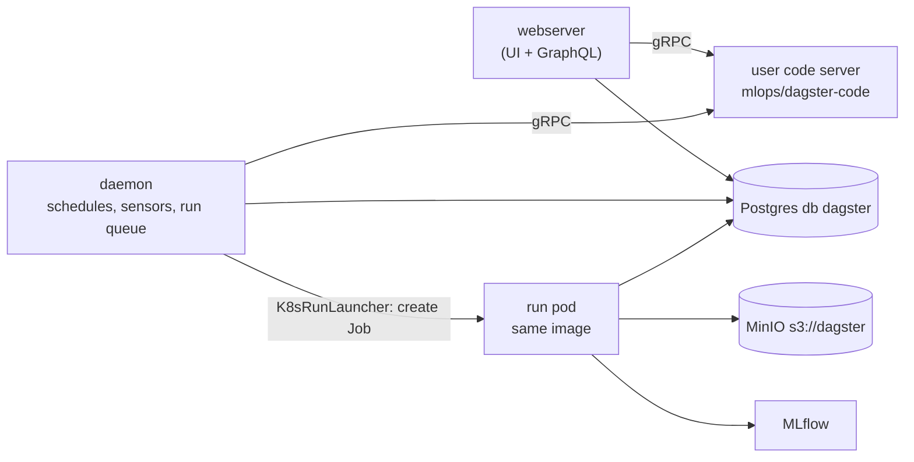

# M5: Dagster on Kubernetes

## 1. Problem to solve

`dagster dev` on your machine is a single process with SQLite history. When the terminal closes, the schedules stop. Every run shares one Python environment, and nothing scales. In production you want:

- the UI and the scheduler running **24/7** in the cluster;
- run history in **Postgres**, so it survives restarts;
- **each run in its own pod**, with its own resources, so a big training run can't starve the UI;
- your code shipped as an **image**, so "what ran" is a tag, not "whatever was on my laptop".



## 2. Foundations

Three long-running services
:   **webserver** (UI and API), **daemon** (evaluates schedules and sensors, dequeues runs) and one **code server** per code location (a gRPC server that loads your `Definitions`). The webserver and daemon never import your code: they ask the code server over gRPC. That's why a broken import shows up as a red code location and doesn't crash the UI.

Code location (user code deployment)
:   An image plus the command that serves it (`dagster api grpc -m mlops_course.pipelines.definitions`). You can have several, one per team or project, each with its own dependencies.

Run launcher
:   Decides *where* a run executes. `K8sRunLauncher` creates a **Kubernetes Job per run**, using the code location's image. Inside the run pod, steps run as subprocesses by default. The `k8s_job_executor` would create one pod **per step** instead.

Instance
:   The shared configuration (`dagster.yaml`): storage (Postgres), run launcher, run coordinator. The chart renders it into a ConfigMap and mounts it everywhere, including run pods.

Run coordinator
:   `QueuedRunCoordinator`: runs are queued and the daemon starts at most `maxConcurrentRuns` at a time. A 90-day backfill doesn't create 90 pods at once.

`includeConfigInLaunchedRuns`
:   Copies the code deployment's image, env, Secrets and pull policy into its run pods. Without it, run pods don't get your env vars.

!!! abstract "YouTube keywords"
    `dagster helm chart kubernetes`, `dagster k8s run launcher`, `dagster user code deployment`, `dagster queued run coordinator`, `helm values external postgres`

## 3. Build it step by step

### Step 1: Dependencies for the cluster

Run pods use the Dagster instance in Postgres and are launched by the Kubernetes integration, so your image needs both libraries:

```bash
uv add dagster-k8s==0.29.26 dagster-postgres==0.29.26
```

### Step 2: The user-code image

```dockerfile title="platform/images/dagster-code/Dockerfile"
--8<-- "reference/m05/platform/images/dagster-code/Dockerfile"
```

The build context is the repo root, so add a `.dockerignore` that only lets in what the image needs:

```text title=".dockerignore"
--8<-- "reference/m05/.dockerignore"
```

```bash
docker build -f platform/images/dagster-code/Dockerfile -t mlops/dagster-code:0.1.0 .
docker images mlops/dagster-code:0.1.0          # ~1.5 GB (torch + mlflow + polars ...)
# smoke test: definitions load inside the image
docker run --rm mlops/dagster-code:0.1.0 dagster definitions validate -m mlops_course.pipelines.definitions
k3d image import mlops/dagster-code:0.1.0 -c mlops
```

!!! info "Why the cache mount?"
    Without `--mount=type=cache`, uv's download cache ends up inside a layer, and the image was **3.1 GB** instead of 1.5 GB.

### Step 3: Namespace and Secrets

=== "00-namespace.yaml"

    ```yaml
    --8<-- "reference/m05/platform/k8s/dagster/00-namespace.yaml"
    ```

=== "10-secrets.yaml"

    ```yaml
    --8<-- "reference/m05/platform/k8s/dagster/10-secrets.yaml"
    ```

```bash
kubectl apply -f platform/k8s/dagster/
```

The Postgres database `dagster` was already created in M1 by the init script.

### Step 4: Chart values

Look at the full default values first. They run to about 1,500 lines, almost all of them comments:

```bash
helm repo add dagster https://dagster-io.github.io/helm && helm repo update
helm show values dagster/dagster --version 1.13.26 | less
```

Then override only what you need:

```yaml title="platform/helm-values/dagster.yaml"
--8<-- "reference/m05/platform/helm-values/dagster.yaml"
```

!!! bug "A real error hit while writing this module"
    Run pods crashed with `ModuleNotFoundError: No module named 'psycopg'`. **SQLAlchemy 2.1** (pulled in by our lockfile) maps `postgresql://` to the psycopg **3** driver, but `dagster-postgres` installs psycopg**2**. The official webserver image still has SQLAlchemy 2.0, so the UI worked and only *our* pods failed. The fix is `postgresqlScheme: postgresql+psycopg2`. It's the same root cause as MLflow in M3.

### Step 5: Install

```bash
helm upgrade --install dagster dagster/dagster --version 1.13.26 -n dagster \
  -f platform/helm-values/dagster.yaml --wait --timeout 10m
kubectl -n dagster get pods
# dagster-daemon-...                            1/1 Running
# dagster-dagster-user-deployments-churn-...    1/1 Running
# dagster-dagster-webserver-...                 1/1 Running
```

Open `http://dagster.192.168.1.202.nip.io:8080`. Under **Deployment**, then **Code locations**, `churn` should be green.

### Step 6: Launch a run and watch the Job

From the UI: **Jobs**, then **daily_ingest**, **Materialize**, and choose partition 2026-10-05. Or from the CLI inside the webserver pod:

```bash
W="kubectl -n dagster exec deploy/dagster-dagster-webserver -c dagster --"
$W dagster job launch -w /dagster-workspace/workspace.yaml -l churn -j daily_ingest \
  --tags '{"dagster/partition": "2026-10-05"}'
kubectl -n dagster get jobs,pods -w           # dagster-run-<run id>
kubectl -n dagster logs -f job/dagster-run-<run id>
```

### Step 7: The full drift loop, in the cluster

```bash
$W dagster sensor start drift_sensor -w /dagster-workspace/workspace.yaml -l churn
$W dagster job launch -w /dagster-workspace/workspace.yaml -l churn -j daily_ingest \
  --tags '{"dagster/partition": "2026-10-06"}' \
  --config-json '{"ops":{"raw_customers":{"config":{"drift":0.9}}}}'
```

Within a minute a second Job appears for the `training` run. When it finishes, MLflow has a new `churn-classifier` version, promoted to `@champion` if it beat the old one.

```bash
git add .dockerignore platform pyproject.toml uv.lock && git commit -m "m05: dagster on k8s" && git tag m05-done
```

!!! tip "Catch-up"
    `make catchup-m05` builds and imports the image, installs the chart and starts the sensor.

### Updating your code

Change code, then build a **new tag** (`0.1.1`), import it, bump the `tag` in the values and run `helm upgrade`. Never reuse a tag: with `IfNotPresent`, nodes keep the old image under the same tag. M7 automates this with CI and Harbor, and M8 with ArgoCD.

## 4. Tweak and observe

1. **Run queue.** Set `maxConcurrentRuns: 1`, `helm upgrade`, then launch three partitions quickly. Watch them in **Runs**, then **Queued**.
2. **Resources per run.** Lower `runK8sConfig.containerConfig.resources.limits.memory` to `300Mi` and launch `training`. What does the Job show? (`kubectl describe pod`: OOMKilled.) Dagster can also take this per job, through the tag `dagster-k8s/config`.
3. **Run pod lifetime.** `ttlSecondsAfterFinished: 60`: watch finished Jobs disappear. The run history stays in Postgres.
4. **Kill the daemon.** `kubectl -n dagster delete pod -l component=dagster-daemon`. Do the sensor ticks resume? Is any state lost?
5. **Where is the instance config?** `kubectl -n dagster get cm dagster-instance -o yaml`: the chart rendered your values into `dagster.yaml`.
6. **Step isolation.** Read about `k8s_job_executor` (one pod per step) and think about when it's worth it: GPU steps, very different resources per step.

## 5. Break and fix

Each check installs a full Dagster release (with its own database) in a throw-away namespace, waits for it, and launches one `daily_ingest` run. Each takes 1 to 2 minutes.

```bash
make check-m05 BUG=bug01
```

**bug01-pull-policy.** Symptom: the code server pod is stuck in `ErrImagePull`, and the code location never loads.

??? success "Solution"
    The chart default `pullPolicy: Always` makes the kubelet pull `docker.io/mlops/dagster-code`, which doesn't exist. The image was imported with `k3d image import`, so use `IfNotPresent`. Once a registry is involved (M7), `Always` with immutable tags is a sound choice again.

**bug02-pg-driver.** Symptom: the UI works, and runs are submitted, but every run fails at start with `ModuleNotFoundError: No module named 'psycopg'`.

??? success "Solution"
    `postgresqlScheme` is missing. Our image has SQLAlchemy 2.1, which picks psycopg 3 for `postgresql://`. Set `postgresqlScheme: postgresql+psycopg2`. Why does only the run fail? The run pod is the only component that writes to the instance DB **with our image**.

**bug03-run-env.** Symptom: the code location is green, but runs fail in resource initialization with `DagsterInvalidConfigError` (an environment variable is not set).

??? tip "Hint"
    `kubectl -n <ns> get pod <run pod> -o yaml | grep -A5 envFrom`: does the run pod see `dagster-lab-env`?

??? success "Solution"
    `includeConfigInLaunchedRuns.enabled: false`, so the code server has the env Secret, but run pods don't. Enable it, or set `envSecrets` under `runLauncher.config.k8sRunLauncher` as well.

**bug04-grpc-module.** Symptom: the code server pod is in `CrashLoopBackOff`.

??? success "Solution"
    `-m mlops_course.pipelines` points to the package, but `defs` lives in `mlops_course.pipelines.definitions`. Test this before deploying, using `docker run ... dagster definitions validate -m ...`.

**bug05-pg-secret.** Symptom: pods stay in `CreateContainerConfigError`.

??? success "Solution"
    `global.postgresqlSecretName` points to `dagster-lab-env`, which has no `postgresql-password` key. `kubectl describe pod` shows *couldn't find key postgresql-password in Secret*. Point it at `dagster-postgresql`.

## 6. Gotchas and best practices

- **The webserver and daemon never import your code.** Debug code problems in the **code server** pod logs.
- **The same image** serves the code location and runs every run pod. Version it with an immutable tag.
- **`IfNotPresent` for `k3d image import`**, because the chart defaults to `Always`.
- **Pin the DB driver** (`postgresqlScheme: postgresql+psycopg2`) with SQLAlchemy 2.1.
- **Secrets outside the chart** (`generatePostgresqlPasswordSecret: false`), referenced by name.
- **In-cluster URLs** in pod env (`minio.storage.svc.cluster.local`), not Ingress hostnames.
- **`includeConfigInLaunchedRuns`**, or run pods lack your env.
- **Cap concurrency** with `QueuedRunCoordinator`, and clean up with `ttlSecondsAfterFinished`.
- **`failPodOnRunFailure: true`**, so the Kubernetes Job status matches the run status (useful for alerts).
- **`NoOpComputeLogManager`** means raw stdout is only in `kubectl logs`, which disappear with the pod. In production, use `S3ComputeLogManager`, which needs `dagster-aws` in every image.
- **`--set` on list items** (`deployments[0].image.tag`) replaces the whole list entry. Keep lists in values files.
