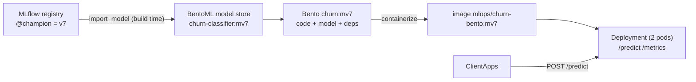

# M6: Model serving with BentoML

## 1. Problem to solve

`churn-classifier@champion` lives in the MLflow registry, but client apps need an **HTTP API** that:

- validates requests (bad input gets a `400`, not a stack trace);
- loads the model **once** per process and serves many requests;
- says **which model version** answered;
- exposes **Prometheus metrics** (latency, errors, score distribution);
- ships as an image that can be rolled out and rolled back.



## 2. Foundations

Service
:   A Python class decorated with `@bentoml.service`. `__init__` loads the model once per **worker** process. Methods decorated with `@bentoml.api` become HTTP endpoints. Type hints (Pydantic models) define and **validate** the request and response schema.

Model store
:   A local registry (`~/bentoml/models`). `bentoml.mlflow.import_model` copies an MLflow model in under a tag such as `churn-classifier:mv7`.

Bento
:   The build artifact: your service code plus the model(s) it references plus the Python and system dependencies (`bentofile.yaml`). It's immutable and versioned. `bentoml containerize` turns it into an OCI image.

Build-time vs run-time model resolution
:   You can resolve `@champion` when the pod **starts** (always the latest, but you can't tell what a pod serves, and a restart can silently change the model), or when the image is **built** (the image tag *is* the model version). This course resolves at build time: rollout and rollback become ordinary image tag changes, which suits GitOps in M8.

Workers and traffic control
:   `workers=2` runs two processes, each with its own model copy. `max_concurrency` caps in-flight requests; the rest get a fast `503` instead of a growing latency queue.

Endpoints you get for free
:   `/readyz` (model loaded), `/livez` (process alive), `/metrics` (Prometheus) and `/docs` (Swagger UI).

!!! abstract "YouTube keywords"
    `bentoml 1.4 service tutorial`, `bentoml mlflow import model`, `bentoml containerize kubernetes`, `model serving readiness probe`, `prometheus histogram model predictions`

## 3. Build it step by step

### Step 1: Install and turn off telemetry

```bash
uv add bentoml==1.4.39
echo 'BENTOML_DO_NOT_TRACK=true' >> .env      # it phones home otherwise
```

### Step 2: Tests first

The request handling lives in a plain class (`ChurnPredictor`) that receives the model through `__init__`. Tests inject a fake model, so no server or MLflow is needed:

```python title="tests/test_serving.py"
--8<-- "reference/m06/tests/test_serving.py"
```

### Step 3: Schemas and predictor

```python title="src/mlops_course/serving/predictor.py"
--8<-- "reference/m06/src/mlops_course/serving/predictor.py"
```

### Step 4: Import the champion

```python title="src/mlops_course/serving/import_model.py"
--8<-- "reference/m06/src/mlops_course/serving/import_model.py"
```

```bash
set -a; source .env; set +a
uv run python -m mlops_course.serving.import_model --alias champion
uv run bentoml models list            # churn-classifier:mv7  bentoml.mlflow ...
```

### Step 5: The service

```python title="src/mlops_course/serving/service.py"
--8<-- "reference/m06/src/mlops_course/serving/service.py"
```

Run it locally and call it:

```bash
uv run bentoml serve mlops_course.serving.service:ChurnService -p 3001
curl -s -X POST localhost:3001/predict -H 'content-type: application/json' -d '{
  "request": {"customers": [{"customer_id": "C1", "plan": "basic", "region": "north",
    "tenure_months": 2, "monthly_spend": 15, "support_tickets_90d": 6,
    "days_since_last_order": 60, "app_sessions_30d": 1, "discount_used": false}]}}'
# {"model_version":"7","predictions":[{"customer_id":"C1","churn_probability":0.97,"churn":true}]}
curl -s localhost:3001/metrics | grep -E "churn_prediction|bentoml_service_request_total"
```

!!! warning "The body is keyed by the parameter name"
    `def predict(self, request: PredictRequest)` expects `{"request": {...}}`. Sending `{"customers": [...]}` returns `400 ... loc: ["request"], Field required`.

### Step 6: Build and containerize

```yaml title="platform/bento/bentofile.yaml"
--8<-- "reference/m06/platform/bento/bentofile.yaml"
```

```bash
uv run bentoml build -f platform/bento/bentofile.yaml src --version mv7
uv run bentoml containerize churn:mv7 -t mlops/churn-bento:mv7
docker run --rm -p 3002:3000 mlops/churn-bento:mv7     # smoke test, then Ctrl+C
```

!!! bug "Two real errors hit while writing this module"
    1. `No solution found ... numpy==2.5.4`: with `extra_index_url` pointing at the PyTorch index, uv takes **every** package from the first index that has it. The PyTorch index also hosts older numpy builds. This is dependency-confusion protection doing its job. The fix is `--find-links` for torch only.
    2. The container crashed with `No module named 'mlops_course.training'`, although `bentoml serve` worked locally. The Bento only contained `mlops_course/serving`. The server imports *that* `mlops_course` first, so the model's own copy of the package (`code_paths`) is never used. This is exercise bug01.

### Step 7: Deploy to k3d

```yaml title="platform/k8s/serving/churn.yaml"
--8<-- "reference/m06/platform/k8s/serving/churn.yaml"
```

```bash
k3d image import mlops/churn-bento:mv7 -c mlops
kubectl apply -f platform/k8s/serving/
kubectl -n serving rollout status deploy/churn
curl -s -X POST http://churn.192.168.1.202.nip.io:8080/model_info
```

Open `http://churn.192.168.1.202.nip.io:8080/docs` for the generated Swagger UI.

```bash
git add src tests platform pyproject.toml uv.lock .env.example && git commit -m "m06: bentoml" && git tag m06-done
```

!!! tip "Catch-up"
    `make catchup-m06` imports `@champion`, builds, containerizes, imports into k3d and rolls out.

### Releasing a new model

When Dagster promotes a new champion (say v8), re-run step 4, then build with `--version mv8`, containerize with `-t mlops/churn-bento:mv8`, import, and change the image tag in the Deployment. M7 puts this in CI, and M8 makes the tag change a Git commit.

## 4. Tweak and observe

1. **Validation.** Send `"plan": "gold"` and then `"tenure_months": -1`. Read the `400` bodies: who rejected them, BentoML or the model?
2. **Rolling update.** Change `replicas` to 3, then roll out a new tag while running `while true; do curl -s -X POST .../model_info; echo; done`. Do you see any errors? Why not? (`maxUnavailable: 0` plus the readiness probe.)
3. **Concurrency limit.** Set `max_concurrency: 1` and fire 20 parallel requests (`xargs -P 20`). Count the `503`s.
4. **Score metric.** Send 100 high-risk customers, then look at `churn_prediction_probability_bucket` in `/metrics`. In M10 this becomes a Grafana panel and a drift signal.
5. **Memory.** `kubectl top pod -n serving`. Change `workers` to 4: what happens to memory? Then compare the scaling options: more workers per pod versus more pods.
6. **Rollback.** `kubectl -n serving rollout undo deploy/churn`, then check `/model_info`.

## 5. Break and fix

```bash
make check-m06              # bug01/02 need churn-classifier in the local BentoML store (step 4)
```

**bug01-shadowed-package** (`bentofile.yaml`). Symptom: `bentoml serve` works locally, but the container exits with `ModuleNotFoundError: No module named 'mlops_course.training'`.

??? tip "Hint"
    List the Python files inside the Bento: `find $(uv run bentoml get churn:<ver> -o path)/src -name '*.py'`. Which `mlops_course` does the server import first?

??? success "Solution"
    `include` only lists `mlops_course/serving`. Locally the full package is installed, which hides the problem. Include `mlops_course/training/{__init__,model,features}.py`, the modules the pickled model needs. To catch it before Kubernetes does, smoke-test the **image** (`docker run`), not only `bentoml serve`.

**bug02-dtypes** (`predictor.py`). Symptom: every request returns `500`, and the log shows `MlflowException: Failed to enforce schema ... int64 ... int32`.

??? success "Solution"
    pandas infers `int64` from Python ints, but the logged signature says `int32`, and MLflow refuses an unsafe cast. Cast explicitly with `.astype(FEATURE_DTYPES)`. The unit test with a fake model can't catch this; it needs a test against the real model artifact.

**bug03-request-body** (`client.py`). Symptom: `HTTP 400 ... "loc":["request"], "msg":"Field required"`.

??? success "Solution"
    BentoML maps top-level JSON keys to the **parameter names** of the API method. The body must be `{"request": {"customers": [...]}}`.

**bug04-target-port** (`churn.yaml`). Symptom: pods are Ready, but `curl http://churn:3000/...` from inside the cluster gets *connection refused*.

??? success "Solution"
    The Service's `targetPort` points at the `metrics` port (3001). The image *exposes* 3001 too (`docker inspect`), but nothing listens there by default. BentoML serves the API **and** `/metrics` on 3000. Use `targetPort: http`.

## 6. Gotchas and best practices

- **Resolve the alias at build time.** The image tag (`mv7`) then says what is served, and `/model_info` confirms it.
- **`BentoModel("...:latest")`** means the most recently *imported* model in the local store, not the highest version. Build in a clean environment (CI) or pin an exact tag.
- **Smoke-test the container**, not only `bentoml serve`: local environments hide missing files.
- **Signature dtypes:** cast at the edge (`astype`); `int64` versus `int32` is the classic failure.
- **Validate with Pydantic** (`Literal`, `ge=0`, `max_length`) so garbage never reaches the model.
- **Request body keys = parameter names.**
- **Torch CPU wheels** (`--find-links`) keep the image around 1.8 GB instead of over 5 GB.
- **`BENTOML_DO_NOT_TRACK=true`** for air-gapped and on-prem setups.
- **Probes:** a `startupProbe` covers model loading, `readinessProbe` uses `/readyz` and `livenessProbe` uses `/livez`. Never point liveness at something that depends on the model or downstream services.
- **Memory = workers × model size.** Size limits for the *worst* case, and prefer more pods over more workers.
