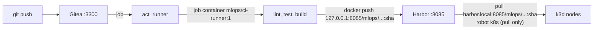

# M7: Gitea CI + Harbor

## 1. Problem to solve

So far, images are built on your shell and copied into k3d with `k3d image import`. Nobody can tell which commit an image came from, tests are optional, and a teammate's cluster can't get the image at all. You need:

- a **Git server** and **CI** that run lint, tests and builds on every push, on-prem;
- a **registry** that stores images with access control, so the cluster *pulls* what CI *pushed*;
- **immutable, traceable tags** (the commit SHA), never `latest`;
- credentials that are **scoped** (robot accounts) and **never printed** in logs.



## 2. Foundations

**From GitLab CI to Actions syntax.** Gitea Actions uses GitHub Actions syntax. If you know `.gitlab-ci.yml`:

| GitLab CI | Gitea/GitHub Actions |
|---|---|
| `.gitlab-ci.yml` | `.gitea/workflows/*.yaml` (or `.github/workflows/`) |
| `stages:` + jobs | `jobs:` with `needs:` (a DAG) |
| `tags: [docker]` (runner selection) | `runs-on: mlops-ci` (runner label) |
| `image: python:3.12` | label mapping in the runner config (`mlops-ci:docker://mlops/ci-runner:1`) |
| `script:` | `steps: - run:` |
| CI/CD variables (masked) | `secrets.*` (masked) and `env:` |
| `$CI_COMMIT_SHORT_SHA` | `${{ github.sha }}` / `git rev-parse --short HEAD` |
| `artifacts`/`dotenv` between jobs | `outputs:` via `$GITHUB_OUTPUT` |
| `interruptible` + auto-cancel | `concurrency: cancel-in-progress` |

act_runner
:   Gitea's runner (the equivalent of gitlab-runner with the docker executor). Each job runs in a fresh container. We mount the host's Docker socket so `docker build/push` inside a job uses the **host daemon**.

Harbor
:   A registry with projects, RBAC, **robot accounts**, tag immutability, retention policies, vulnerability scanning (Trivy, optional) and replication.

Robot account
:   A non-human credential limited to one project and specific actions. `ci` can push and pull; `k8s` can only pull. If one leaks, you revoke one robot, not your admin.

Tag immutability
:   A Harbor rule: once `churn-bento:mv7-1a2b3c4d` exists, it can never be overwritten. What ran yesterday is still exactly what that tag points to today.

Push name vs pull name (lab-specific)
:   Docker only allows plain HTTP to `127.0.0.0/8` (`docker info`, *Insecure Registries*). Changing that needs root, which we don't have. So CI pushes to `127.0.0.1:8085/...`, and k3d pulls the **same images** as `harbor.local:8085/...` through the HTTP mirror configured in M0 (`registries.yaml`). With TLS and DNS, which is what you'd do in production, both names become `harbor.example.com/...`.

!!! abstract "YouTube keywords"
    `harbor registry robot account`, `gitea actions act_runner docker`, `github actions self-hosted runner`, `immutable image tags`, `containerd insecure registry k3s registries.yaml`

## 3. Build it step by step

### Step 1: Harbor

```yaml title="infra/compose/harbor/harbor.yml.tpl"
--8<-- "reference/m07/infra/compose/harbor/harbor.yml.tpl"
```

```bash title="infra/compose/harbor/setup.sh"
--8<-- "reference/m07/infra/compose/harbor/setup.sh"
```

```bash
infra/compose/harbor/setup.sh            # first run pulls ~10 images
docker ps --format '{{.Names}} {{.Status}}' | grep -E 'harbor|registry|nginx|redis'
```

!!! bug "A real error hit while writing this module"
    `install.sh` failed with `open .../common/config/registryctl/env: permission denied`. `prepare` writes 0600 files as root, and `docker compose` runs as you. The script runs `prepare` itself and relaxes the permissions with a throw-away container.

### Step 2: Project, immutability, robots

```bash title="infra/compose/harbor/bootstrap.sh"
--8<-- "reference/m07/infra/compose/harbor/bootstrap.sh"
```

```bash
infra/compose/harbor/bootstrap.sh
source infra/compose/harbor/robots.env
printf '%s' "$HARBOR_CI_SECRET" | docker login 127.0.0.1:8085 -u "$HARBOR_CI_USER" --password-stdin
docker tag busybox:1.37 127.0.0.1:8085/mlops/smoke:1 && docker push 127.0.0.1:8085/mlops/smoke:1
```

Open `http://YOUR_SERVER_IP:8085` (admin / `Harbor-lab-12345`): **Projects**, then **mlops**, **Repositories**.

### Step 3: Let the cluster pull

```bash title="infra/compose/harbor/k8s-pull-secret.sh"
--8<-- "reference/m07/infra/compose/harbor/k8s-pull-secret.sh"
```

```bash
infra/compose/harbor/k8s-pull-secret.sh serving dagster
kubectl -n serving run smoke --image=harbor.local:8085/mlops/smoke:1 --restart=Never -- echo pulled
kubectl -n serving logs smoke && kubectl -n serving delete pod smoke
```

### Step 4: Gitea and the runner

=== "compose.yaml"

    ```yaml
    --8<-- "reference/m07/infra/compose/gitea/compose.yaml"
    ```

=== "runner-config.yaml"

    ```yaml
    --8<-- "reference/m07/infra/compose/gitea/runner-config.yaml"
    ```

=== "setup.sh"

    ```bash
    --8<-- "reference/m07/infra/compose/gitea/setup.sh"
    ```

=== "CI job image"

    ```dockerfile
    --8<-- "reference/m07/platform/images/ci-runner/Dockerfile"
    ```

```bash
infra/compose/gitea/setup.sh
docker logs gitea-runner-1 | tail -2        # "... with labels: [mlops-ci], declare successfully"
```

!!! bug "Another real error"
    The first job failed with `Could not resolve host: gitea`. Jobs get `github.server_url` from the URL the **runner registered with** (`GITEA_INSTANCE_URL`), not from Gitea's `ROOT_URL`, and job containers run on their own network. The fix is to register with `http://<SERVER_IP>:3300`.

### Step 5: The workflow

```yaml title=".gitea/workflows/ci.yaml"
--8<-- "reference/m07/.gitea/workflows/ci.yaml"
```

!!! bug "And a third one"
    `docker login` returned `unauthorized` with correct credentials. The robot is called `robot$mlops+ci`. `${{ secrets.HARBOR_USER }}` is pasted into the script **before** bash runs, and bash expanded `$mlops` to nothing. Pass secrets through `env:`.

### Step 6: Push your repo and watch it run

```bash
git remote add gitea http://YOUR_SERVER_IP:3300/mlops/mlops.git
git push gitea main            # user mlops / mlops-gitea-secret
```

Open `http://YOUR_SERVER_IP:3300/mlops/mlops/actions`. The `test` job takes about a minute; `images` takes 3 to 5 minutes the first time (later runs are faster thanks to the uv cache volume and Docker layer cache). Then:

```bash
# in Harbor UI: mlops/dagster-code:<sha8>, mlops/churn-bento:mv7-<sha8>
kubectl -n serving set image deploy/churn bento=harbor.local:8085/mlops/churn-bento:mv7-<sha8>
kubectl -n serving rollout status deploy/churn
```

```bash
git add .gitea infra platform .gitignore && git commit -m "m07: ci + harbor" && git tag m07-done
```

!!! tip "Catch-up"
    `make catchup-m07` runs Harbor setup and bootstrap, Gitea setup and the pull secrets. Pushing your repo is the manual step 6.

### Variant: GitHub with a self-hosted runner

The workflow file is plain GitHub Actions. To run the same CI from a GitHub repo on this LXC (only the runner calls GitHub; your cluster stays private):

1. In the repo, go to **Settings**, then **Actions**, **Runners**, **New self-hosted runner**, choose Linux x64, and follow the `config.sh` steps on the LXC with `--labels mlops-ci`.
2. Copy `.gitea/workflows/ci.yaml` to `.github/workflows/ci.yaml`.
3. Replace the `checkout` steps with `uses: actions/checkout@v4`, which is available on GitHub.
4. Add `HARBOR_USER`, `HARBOR_PASSWORD` and `MLFLOW_TRACKING_URI` as repository secrets.
5. The host runner executes jobs **directly on the LXC** (no job container), so install `uv` there. It already has Docker.

## 4. Tweak and observe

1. **Immutability in action.** Push `smoke:1` again with different content (`docker tag alpine:3 ...`). Read Harbor's error. Then disable the rule in the UI and try again: what can go wrong now?
2. **Fail fast.** Break a test and push. Is `images` skipped? Now remove `needs: test` and push again.
3. **Masking.** Add `run: echo "${{ secrets.HARBOR_PASSWORD }}"` and look at the log (`***`). Then try `echo "${{ secrets.HARBOR_PASSWORD }}" | base64`. Masking only matches the exact value.
4. **Concurrency.** Push twice within 10 seconds: the first run is cancelled.
5. **Layer caching.** Change only `service.py`, push, and compare the `dagster code image` step time. Which Dockerfile layers were rebuilt?
6. **Scanning.** Re-run `installer/install.sh --with-trivy`, scan `churn-bento` in the UI, and read the CVE list of a Debian base image.

## 5. Break and fix

```bash
make check-m07     # needs Harbor + robots.env; bug02/03 also need the cluster
```

**bug01-push-name** (`push.sh`). Symptom: `http: server gave HTTP response to HTTPS client`.

??? success "Solution"
    Docker uses HTTPS for every registry except `127.0.0.0/8` and those in `insecure-registries` (root-only `daemon.json`). Push to `127.0.0.1:8085`. In production, give Harbor a TLS certificate instead.

**bug02-pull-name** (`image.txt`). Symptom: `ErrImagePull`, with the same *HTTP response to HTTPS client* message, but from **containerd** in the k3d node.

??? success "Solution"
    containerd only uses HTTP for registries listed in k3s `registries.yaml`, and we configured `harbor.local:8085` (M0). The pull secret's `--docker-server` must also match that prefix. Use `harbor.local:8085/mlops/smoke:1`. To trust another name you'd edit `registries.yaml` and restart the k3s nodes.

**bug03-latest-tag** (`release.sh`). Symptom: `Failed to process request due to 'ex-hello:latest' configured as immutable`.

??? success "Solution"
    Every release pushes `latest`. Harbor refuses to overwrite it, and even without the rule, nodes with a cached `latest` would keep running old code (`IfNotPresent`), so you'd never know which version runs where. Tag each release uniquely (`$version` or the commit SHA).

**bug04-secret-in-script** (`ci.yaml`). Symptom: the login step works, but the log shows `+ docker login ... -p ***` and Docker warns *Using --password via the CLI is insecure*.

??? success "Solution"
    Three problems in one step: `${{ secrets.* }}` is inlined into the script (it breaks on `$` and allows script injection), `-p` puts the password in the process list, and `set -x` echoes every command. Use `env:` plus `--password-stdin`. Masking is a last line of defence, not a design.

**bug05-needs** (`ci.yaml`). Symptom: none, until a broken commit's image reaches Harbor and gets deployed.

??? success "Solution"
    `images` has no `needs: test`, so it runs **in parallel** with the tests, and a red test still publishes an image. Add `needs: test`.

## 6. Gotchas and best practices

- **Push name vs pull name** (lab only). In production use TLS and DNS, and give Harbor one name everywhere.
- **The token realm (`hostname` in harbor.yml)** must resolve from every client, or logins fail after a 401 redirect.
- **CI builds serving images, not Dagster.** Import `@champion`, bento build, Harbor push, GitOps tag bump — see [Model delivery paths](../cheatsheets/model-delivery.md).
- **Immutable SHA tags**, never `latest`, plus Harbor tag immutability as a safety net.
- **Robot accounts per purpose:** CI can push and pull, the cluster can only pull, and admin credentials stay out of automation.
- **Secrets via `env:`** and `--password-stdin`; never inline them in `run:`, and never use `set -x` near secrets.
- **`needs:`** turns jobs into a DAG. Without it, jobs run in parallel.
- **Runner `GITEA_INSTANCE_URL`** becomes `github.server_url` in jobs, so it must be reachable from job containers.
- **No `uses:` from github.com** in an air-gapped setup: either mirror actions into Gitea (`DEFAULT_ACTIONS_URL: self`) or use plain `run:` steps.
- **The Docker socket in jobs** means jobs control the host daemon (they're effectively root on the LXC). That's acceptable for a private lab; for shared runners use rootless BuildKit or Kaniko.
- **`docker build` context is uploaded** from the job container to the host daemon. Bind mounts (`-v $PWD:...`) would refer to **host** paths, not the job's.
