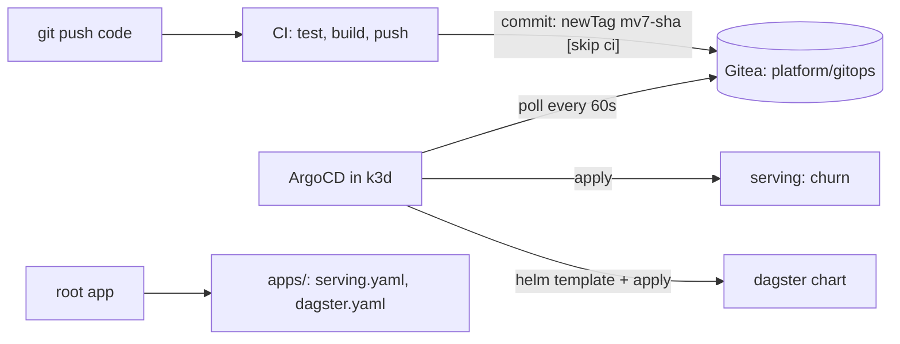

# M8: GitOps with ArgoCD

## 1. Problem to solve

CI now pushes `churn-bento:mv7-<sha>` to Harbor, but someone still runs `kubectl set image` or `helm upgrade` by hand. Nobody knows what is *supposed* to run, a manual `kubectl edit` survives forever, and rolling back means remembering old commands. GitOps fixes this:

- **Git is the source of truth** for what runs in the cluster;
- an agent **in** the cluster (ArgoCD) continuously makes the cluster match Git;
- CI never gets cluster credentials: it only commits a new image tag;
- rollback is `git revert`; drift is detected and reverted.



## 2. Foundations

Application
:   An ArgoCD custom resource: *render this source* (a Git path with plain YAML, Kustomize or a Helm chart) *and keep it applied to this destination* (cluster plus namespace).

Sync status vs health status
:   **Synced/OutOfSync**: does the cluster match Git? **Healthy/Progressing/Degraded**: does it work (Deployment rolled out, pods ready)? You can be *Synced* and *Degraded* at the same time, for example when the image doesn't start.

Automated sync, prune, selfHeal
:   **automated** applies new commits without a click. **prune** deletes resources removed from Git. **selfHeal** reverts changes made directly in the cluster.

App of apps
:   One **root** Application points at a folder of Application manifests. Adding a component means adding a file, and you only apply one thing by hand.

Sync waves
:   `argocd.argoproj.io/sync-wave: "-1"` resources (or child apps) are applied and must be **Healthy** before wave `0` starts. This is how you get CRDs before CRs, and namespaces and secrets before workloads.

Multi-source
:   An app can combine an upstream Helm chart with **your** values file from Git (`$values/...`). You don't fork the chart and you don't keep a values copy outside Git.

Kustomize `images:`
:   Rewrites image references at render time. CI changes one line (`newTag`) and nothing else.

!!! abstract "YouTube keywords"
    `argocd app of apps`, `argocd sync waves`, `argocd multiple sources helm values`, `gitops image tag update ci`, `argocd self heal prune`

## 3. Build it step by step

### Step 1: Install ArgoCD

```yaml title="platform/argocd/values.yaml"
--8<-- "reference/m08/platform/argocd/values.yaml"
```

### Step 2: The GitOps folder

=== "apps/serving.yaml"

    ```yaml
    --8<-- "reference/m08/platform/gitops/apps/serving.yaml"
    ```

=== "apps/dagster.yaml"

    ```yaml
    --8<-- "reference/m08/platform/gitops/apps/dagster.yaml"
    ```

=== "serving/kustomization.yaml"

    ```yaml
    --8<-- "reference/m08/platform/gitops/serving/kustomization.yaml"
    ```

=== "serving/churn.yaml"

    ```yaml
    --8<-- "reference/m08/platform/gitops/serving/churn.yaml"
    ```

`platform/gitops/dagster/values.yaml` is the M5 values file with two changes: the image is `harbor.local:8085/mlops/dagster-code` with a `# ci:dagster-tag` marker, and `dagster-user-deployments.imagePullSecrets` is added (see the bug box below).

Check what Argo will render, locally:

```bash
kubectl kustomize platform/gitops/serving | grep image:
```

### Step 3: Root app and bootstrap

=== "root-app.yaml"

    ```yaml
    --8<-- "reference/m08/platform/argocd/root-app.yaml"
    ```

=== "bootstrap.sh"

    ```bash
    --8<-- "reference/m08/platform/argocd/bootstrap.sh"
    ```

```bash
git add platform/gitops platform/argocd && git commit -m "m08: gitops" && git push gitea main
helm -n dagster uninstall dagster --wait    # hand-over: Argo CD owns Dagster from now on
platform/argocd/bootstrap.sh
kubectl -n argocd get applications -w       # root, dagster, serving -> Synced / Healthy
```

Open `http://argocd.YOUR_SERVER_IP.nip.io:8080` (user `admin`, password printed by the script). Click `serving` to see the resource tree.

!!! bug "A real error hit while writing this module"
    After the hand-over, the Dagster code server was stuck in `ImagePullBackOff`. The pull secret had been attached to the namespace's `default` ServiceAccount (M7), but the chart runs its pods under **its own** ServiceAccount. The fix is `dagster-user-deployments.imagePullSecrets` in the values, which run pods also inherit.

### Step 4: CI bumps the tag

The workflow gets a third job (and `paths-ignore` so the bump commit doesn't trigger a rebuild):

```yaml title=".gitea/workflows/ci.yaml"
--8<-- "reference/m08/.gitea/workflows/ci.yaml"
```

Push a code change and follow it end to end:

```bash
git commit -am "serving: tweak" && git push gitea main
# Gitea Actions: test -> images -> deploy (3-5 min)
git pull gitea main && git log --oneline -2
#   c12e5bab deploy: churn-bento mv7-d2747121, dagster-code d2747121 [skip ci]
#   d2747121 serving: tweak
kubectl -n serving get deploy churn -o jsonpath='{.spec.template.spec.containers[0].image}'
```

!!! warning "Pull before you push"
    CI commits to `main`. Run `git pull --rebase gitea main` before your next push, or Git rejects it as non-fast-forward.

```bash
git tag m08-done
```

!!! tip "Catch-up"
    `make catchup-m08` copies the files, uninstalls the Helm-CLI Dagster release and bootstraps ArgoCD. Commit and push `platform/` yourself.

## 4. Tweak and observe

1. **Self-heal.** `kubectl -n serving scale deploy/churn --replicas=5`. How long until it's back at 2? Look at the app's **History and Rollback** and the events.
2. **Prune.** Add a ConfigMap to `platform/gitops/serving/`, push, wait, then delete the file and push again. Without `prune: true`, the ConfigMap would stay, and the app would only show it as needing pruning.
3. **Rollback via Git.** `git revert <deploy commit>` and push. Argo rolls back to the previous tag, and the history in Git says who did it and why.
4. **Diff before sync.** Disable `automated` on `serving` (in Git!), change `replicas`, push, and open **App Diff** in the UI.
5. **Health vs sync.** Set `newTag` to a tag that doesn't exist. The app is *Synced* but *Degraded* (`ImagePullBackOff`), and the old ReplicaSet keeps serving. Why? (`maxUnavailable: 0`.)
6. **Webhook instead of polling.** In Gitea, go to repo **Settings**, then **Webhooks**, and add `http://argocd.YOUR_SERVER_IP.nip.io:8080/api/webhook` (push events). Deploys now start within seconds.

## 5. Break and fix

Each check pushes the folder as a throw-away Gitea repo (`mlops/ex-m08-bugNN`), creates the Application(s) and waits for ArgoCD. bug01 to bug03 take about a minute each; bug04 takes up to 4 minutes.

```bash
make check-m08 BUG=bug01
```

**bug01-wrong-path** (`app.yaml`). Symptom: the app is `Unknown`, with `ComparisonError ... app path does not exist`.

??? success "Solution"
    `path: manifest`, but the folder is `manifests`. Argo renders nothing it can't find. Check with `git ls-tree -d main` and keep the paths in the Application next to the folders they point at.

**bug02-target-revision** (`app.yaml`). Symptom: `unable to resolve 'master' to a commit SHA`.

??? success "Solution"
    The repo's branch is `main`. `targetRevision` accepts a branch, a tag or a commit SHA. Pin a tag or SHA for production, and track a branch for environments that should follow every commit.

**bug03-self-heal** (`app.yaml`). Symptom: the app is Healthy, but after a manual `kubectl scale --replicas=4` it stays at 4. The UI shows *OutOfSync*, and nothing happens.

??? success "Solution"
    `automated` without `selfHeal: true` only syncs on **new commits**. Manual drift stays until the next commit. Enable `selfHeal`, and remove humans' write access to managed namespaces.

**bug04-crd-wave** (`apps/*.yaml`). Symptom: the `crds` app never appears, and the `cards` app fails with *could not find mlops.example.com/ModelCard ... Make sure the CRD is installed*.

??? tip "Hint"
    Compare the `sync-wave` annotations of the two child apps. Which one must exist first?

??? success "Solution"
    The CRD app is in wave `1` and the app using the CRD is in wave `0`. The root applies wave 0 first, waits for it to become Healthy (which it never does), and never reaches wave 1. Put CRDs in a lower wave (`-1`). This only works because `values.yaml` adds a health check for `Application`; without it, waves don't wait at all.

## 6. Gotchas and best practices

- **Git is the only write path.** Manual changes are reverted (`selfHeal`) or forgotten.
- **CI commits tags; it never runs `kubectl`.** The cluster pulls, so CI needs no cluster credentials.
- **Avoid CI loops:** use `[skip ci]` in the bump commit **and** `paths-ignore` for the GitOps folder.
- **Pull before push:** CI writes to `main` too. Some teams use a separate GitOps repo for exactly this reason.
- **Application health check** (`resource.customizations.health.argoproj.io_Application`), or app-of-apps waves don't wait.
- **Waves:** CRDs and operators at `-1`, workloads at `0` and above.
- **Charts run pods under their own ServiceAccounts.** Set the chart's `imagePullSecrets`.
- **Secrets are not in Git** here (they're created by scripts). In production use Sealed Secrets or External Secrets, still GitOps but encrypted or referenced.
- **The `resources-finalizer`** means deleting an Application deletes its resources. Without it, the resources are orphaned.
- **Pin chart versions** (`targetRevision: 1.13.26`): an upgrade is a reviewed commit.
- **Hand-over from the Helm CLI:** `helm uninstall` first, or two tools fight over the same objects.
