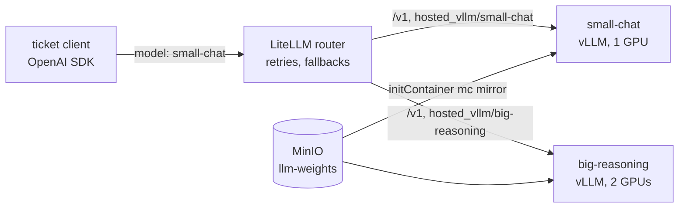

# M9: LLM serving with vLLM and a router

## 1. Problem to solve

Support tickets (M2) need an LLM answer. Simple tickets (billing, shipping, chit-chat) are fine with a **small, fast** model. Technical problems and cancellations need a **big** model with a long context. On-prem you have to:

- serve each model with **vLLM** on its own GPU budget, with weights coming from **your** storage (no Hugging Face Hub at runtime);
- survive model load times of minutes without Kubernetes killing the pod;
- give applications **one** OpenAI-compatible endpoint that routes, retries, falls back and enforces timeouts.

There's no GPU in this lab, so the model is a **mock** that behaves like `vllm serve`: same flags, same API, same `/health`, same metric names, a realistic load time and token speed. Everything around it (chart, weights download, probes, router, metrics, autoscaling in M10) is the real thing. Switching to real vLLM is `mock: false`.



## 2. Foundations

vLLM
:   An inference server for LLMs. **PagedAttention** stores the KV cache in pages, so many sequences share GPU memory. **Continuous batching** adds new requests to a running batch token by token, so throughput is many times higher than one request at a time. It speaks the OpenAI API (`/v1/chat/completions`, `/v1/models`).

Key `vllm serve` flags
:   `--served-model-name` (the name clients send), `--max-model-len` (context window; it must fit in the KV cache), `--gpu-memory-utilization` (share of GPU memory vLLM pre-allocates, default 0.9), `--tensor-parallel-size` (GPUs per replica), `--max-num-seqs` (concurrent sequences; extra requests **wait**).

One Deployment per model
:   One vLLM process serves one model. Each model gets its own GPU count, replicas, scaling and rollout. A single Helm chart, installed once per model with a different values file, keeps them consistent.

Weights from object storage
:   An **initContainer** copies the weights from MinIO into a volume before vLLM starts. The cluster never talks to the Hub, so it works air-gapped and you know exactly which bytes are served.

startupProbe
:   Holds off liveness and readiness until the **first** success. `periodSeconds x failureThreshold` is the maximum load time. Without it, a liveness probe kills a pod that is still loading 40 GB of weights, forever.

LLM router (LiteLLM proxy)
:   An OpenAI-compatible proxy in front of all models. Clients choose a **model group** by name, and the router chooses a deployment, retries transient errors, cools down failing backends and falls back to another group (`fallbacks`, `context_window_fallbacks`).

!!! abstract "YouTube keywords"
    `vllm paged attention explained`, `vllm continuous batching`, `vllm kubernetes deployment`, `litellm proxy fallbacks`, `kubernetes startup probe vs liveness probe`

## 3. Build it step by step

### Step 1: The mock vLLM server

Tests first. They pin down the behaviour of the real server that the rest of the course relies on:

```python title="tests/test_mock_vllm.py"
--8<-- "reference/m09/tests/test_mock_vllm.py"
```

```python title="src/mlops_course/llm/mock_vllm.py"
--8<-- "reference/m09/src/mlops_course/llm/mock_vllm.py"
```

```bash
uv add fastapi==0.143.0 uvicorn==0.54.0 openai==3.29.0
touch src/mlops_course/llm/__init__.py
uv run pytest tests/test_mock_vllm.py -q
```

The image holds only the mock's dependencies (56 MB; the real vLLM image is about 10 GB):

```dockerfile title="platform/images/mock-vllm/Dockerfile"
--8<-- "reference/m09/platform/images/mock-vllm/Dockerfile"
```

```bash
docker build -f platform/images/mock-vllm/Dockerfile -t 127.0.0.1:8085/mlops/mock-vllm:0.1.0 .
docker push 127.0.0.1:8085/mlops/mock-vllm:0.1.0      # docker login as in M7
```

### Step 2: Weights in MinIO

```python title="src/mlops_course/llm/fake_weights.py"
--8<-- "reference/m09/src/mlops_course/llm/fake_weights.py"
```

```bash
uv run python -m mlops_course.llm.fake_weights small-chat --size-mb 20 --max-len 4096
uv run python -m mlops_course.llm.fake_weights big-reasoning --size-mb 80 --max-len 16384
```

Open the MinIO console (`minio.192.168.1.202.nip.io:8080`) and look at bucket `llm-weights`.

### Step 3: The `llm-model` chart

=== "values.yaml"

    ```yaml
    --8<-- "reference/m09/platform/charts/llm-model/values.yaml"
    ```

=== "templates/deployment.yaml"

    ```yaml
    --8<-- "reference/m09/platform/charts/llm-model/templates/deployment.yaml"
    ```

=== "templates/service.yaml"

    ```yaml
    --8<-- "reference/m09/platform/charts/llm-model/templates/service.yaml"
    ```

=== "templates/_helpers.tpl"

    ```yaml
    --8<-- "reference/m09/platform/charts/llm-model/templates/_helpers.tpl"
    ```

One values file per model:

=== "small-chat.yaml"

    ```yaml
    --8<-- "reference/m09/platform/gitops/llm-models/small-chat.yaml"
    ```

=== "big-reasoning.yaml"

    ```yaml
    --8<-- "reference/m09/platform/gitops/llm-models/big-reasoning.yaml"
    ```

Compare what mock and real render. Only the image, command, resources and GPU scheduling differ; the vLLM flags are identical:

```bash
helm template x platform/charts/llm-model -f platform/gitops/llm-models/big-reasoning.yaml > /tmp/mock.yaml
helm template x platform/charts/llm-model -f platform/gitops/llm-models/big-reasoning.yaml --set mock=false > /tmp/real.yaml
diff /tmp/mock.yaml /tmp/real.yaml
```

### Step 4: The LiteLLM router

=== "config.yaml"

    ```yaml
    --8<-- "reference/m09/platform/gitops/llm/config.yaml"
    ```

=== "litellm.yaml"

    ```yaml
    --8<-- "reference/m09/platform/gitops/llm/litellm.yaml"
    ```

=== "kustomization.yaml"

    ```yaml
    --8<-- "reference/m09/platform/gitops/llm/kustomization.yaml"
    ```

=== "secrets.yaml"

    ```yaml
    --8<-- "reference/m09/platform/gitops/llm/secrets.yaml"
    ```

### Step 5: Hand it to Argo CD

Three new apps: `llm` (wave 1: secrets plus router) and one app per model (wave 2). Each model app is the **same chart** with a different values file:

=== "apps/llm-small-chat.yaml"

    ```yaml
    --8<-- "reference/m09/platform/gitops/apps/llm-small-chat.yaml"
    ```

=== "apps/llm.yaml"

    ```yaml
    --8<-- "reference/m09/platform/gitops/apps/llm.yaml"
    ```

CI builds the mock image as well and bumps `# ci:mock-vllm-tag` in both values files (new step `mock-vllm image` and one more `sed` in `deploy`):

```yaml title=".gitea/workflows/ci.yaml"
--8<-- "reference/m09/.gitea/workflows/ci.yaml"
```

```bash
infra/compose/harbor/k8s-pull-secret.sh llm
git add platform src tests .gitea pyproject.toml uv.lock
git commit -m "m09: llm serving" && git pull --rebase gitea main && git push gitea main
kubectl -n argocd get applications -w     # llm, llm-small-chat, llm-big-reasoning
kubectl -n llm get pods -w                # Init:0/1 -> Running 0/1 (loading) -> 1/1
```

### Step 6: Use it

The client knows one URL and model **group** names; the route comes from the ticket's intent (M2 `ROUTES`):

```python title="src/mlops_course/llm/client.py"
--8<-- "reference/m09/src/mlops_course/llm/client.py"
```

Run it **inside** the cluster: the Job reads the router key from the Secret, so the key never lands in a file on your machine.

```bash title="platform/llm/run-tickets.sh"
--8<-- "reference/m09/platform/llm/run-tickets.sh"
```

```bash
platform/llm/run-tickets.sh 30 8
#   INFO served by: {'big-reasoning': 6, 'small-chat': 24}
#   INFO 30 tickets in 5.6s, 0 fell back
```

The image is the Dagster code image, which already contains `mlops_course` (rebuilt by CI with the new module). The same client works from your laptop with `LLM_BASE_URL` and `LLM_API_KEY` in `.env`.

!!! bug "A real error hit while writing this module"
    `logging.getLogger("httpx").setLevel(WARNING)` didn't silence the per-request `HTTP Request: POST ...` lines. openai 3.x ships its **own fork** of httpx and logs under the name `httpx2`. When a log line won't go away, print `%(name)s` in the format to see which logger emits it.

```bash
git tag m09-done
```

!!! tip "Catch-up"
    `make catchup-m09` copies the files, pushes the mock image as `0.1.0`, uploads the fake weights and creates the pull secret. Then run the `uv add` from step 1, commit and push.

## 4. Tweak and observe

1. **Context-window fallback.** Send a ~4,000-word prompt to `small-chat`. The router answers from `big-reasoning`, because `enable_pre_call_checks` plus `context_window_fallbacks` catch it before the call fails.
2. **Model down.** `kubectl -n llm scale deploy/big-reasoning --replicas=0` (Argo CD restores it within a minute, thanks to selfHeal). Within that window, requests for `big-reasoning` are answered by `small-chat`, but take about 5 s: `num_retries: 2` with `retry_after: 1` before the fallback. Tune retries against your latency budget.
3. **Queueing.** Run `platform/llm/run-tickets.sh 200 64`. `small-chat` runs 8 sequences at a time (`maxNumSeqs`). Watch the queue: `kubectl -n llm port-forward deploy/small-chat 8000` and `curl -s localhost:8000/metrics | grep num_requests`. M10 scales on exactly this number.
4. **Config change rolls pods.** Change `cooldown_time` in `config.yaml`, then push. The ConfigMap gets a new hashed name, so the router pods restart. With a plain ConfigMap they would keep the old config.
5. **Load time.** Set `sim.loadSeconds: 120` for `big-reasoning`. The pod sits at `0/1 Running` for 2 minutes and is never restarted: that's the startupProbe at work.
6. **Real vLLM.** `helm template` with `--set mock=false` and read the diff: GPU limits, `runtimeClassName`, the toleration, `Recreate` strategy. On a GPU node, that's the only change.

## 5. Break and fix

Each check installs one mock model (and, for bug01 and bug02, a router) in a throw-away namespace. About 1 minute each.

```bash
make check-m09 BUG=bug01
```

**bug01-served-name** (`config.yaml`). Symptom: `404 ... The model `models/small-chat` does not exist`.

??? success "Solution"
    The router sends the part after `hosted_vllm/` as the model name. vLLM only knows its `--served-model-name`. When the flag is missing, the default is the **weights path**, which is where `models/small-chat` comes from. Use `hosted_vllm/small-chat`, and check with `curl <vllm>/v1/models`.

**bug02-api-base** (`config.yaml`). Symptom: `404 ... {"detail":"Not Found"}`. The model exists, but the path doesn't.

??? success "Solution"
    `api_base` must end with `/v1`. The client appends `/chat/completions`. Without `/v1`, it calls `/chat/completions` at the root and gets FastAPI's generic 404. Compare this with bug01's error: vLLM's own message means the URL is right and the name is wrong.

**bug03-startup-probe** (`probes.yaml`). Symptom: the pod restarts again and again (`Startup probe failed: ... connection refused` in `kubectl describe pod`). The model takes 30 s to load.

??? success "Solution"
    `periodSeconds: 2 x failureThreshold: 5` gives 10 s, so the kubelet kills the container before loading ends. The loading starts over every time and it never comes up. Size the budget for the **worst** case (cold disk, big model): `10 x 60` gives 10 minutes. Liveness and readiness stay tight because they only start after the first success.

## 6. Gotchas and best practices

- **Served name = router name.** Always set `--served-model-name`, and use the same string in `hosted_vllm/<name>`.
- **`api_base` ends in `/v1`** for vLLM backends.
- **startupProbe for every model server.** Liveness without it kills slow loaders forever.
- **Liveness `timeoutSeconds` > 1.** A saturated engine answers `/health` slowly; the 1 s default turns load into restarts.
- **One GPU, one pod:** `RollingUpdate` with a surge pod waits forever for a second GPU. Use `Recreate`, or keep 2+ replicas with `maxSurge: 0`.
- **`/dev/shm`:** Docker's 64 MiB default crashes tensor-parallel vLLM with `Bus error`. Mount an in-memory `emptyDir`.
- **Air-gapped:** `HF_HUB_OFFLINE=1` for vLLM and `LITELLM_LOCAL_MODEL_COST_MAP=True` for LiteLLM. Both otherwise try the internet at startup.
- **Weights:** real models are 15 to 150 GB. Use a PVC cache (or a node-local cache) instead of `emptyDir`, or every restart re-downloads everything.
- **Retry in one place.** The router retries, so set `max_retries=0` in the client, or retries multiply under load.
- **Hash your config** (`configMapGenerator`) so config changes restart the pods that read it at startup.
- **Pin images** (`litellm:v1.105.0`, `vllm-openai:v0.31.0`). Both projects ship breaking changes often.
