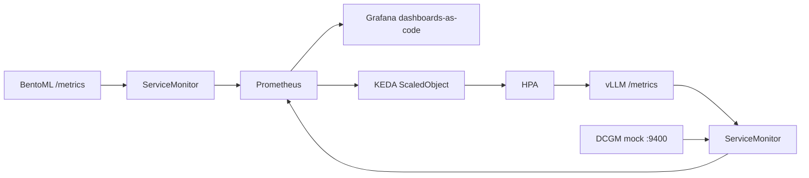

# M10: Observability + KEDA

## 1. Problem to solve

The mock vLLM in M9 already exposes real metric names (`vllm:num_requests_waiting`, TTFT histograms). BentoML exposes `/metrics`. None of that is collected, graphed, or acted on. You cannot answer:

- is the queue growing?
- is a GPU (even a fake one) saturated?
- did the new churn model change the score distribution?
- can we add replicas when the queue grows, and not flap back down?



## 2. Foundations

Prometheus
:   A time-series database that **pulls** metrics by scraping HTTP `/metrics` on a schedule. It does not discover pods by itself.

Prometheus Operator + ServiceMonitor
:   A CRD that means "scrape this Service". kube-prometheus-stack installs Prometheus, Grafana, node-exporter, kube-state-metrics and the operator. The operator only scrapes ServiceMonitors whose labels match its **selector**. Default selector: `release: <helm-release-name>`.

`prometheus.io/scrape` annotations
:   Ignored by the operator. They only work with the old static Prometheus config. If you add the annotation and skip the ServiceMonitor, Grafana stays empty.

KEDA
:   Kubernetes Event-Driven Autoscaling. A ScaledObject creates an HPA and feeds it an external metric. The Prometheus scaler runs your PromQL on a timer.

`metricType: Value` vs `AverageValue`
:   HPA formula is `replicas = ceil(metric / threshold)`. **AverageValue** (KEDA's default) first divides the metric by the current replica count. Queue depth is a cluster-wide number: use **Value**.

Cooldown vs stabilization
:   `cooldownPeriod` only applies to scaling **1 → 0**. Scaling 4 → 1 is the HPA `scaleDown.stabilizationWindowSeconds`. Mixing them up is why people say "KEDA cooldown does nothing".

Scale to zero (HTTP)
:   A Deployment at 0 replicas emits **no** `vllm:*` series. The scaler reads 0 and stays at 0, even if clients are failing. HTTP scale-from-zero needs an interceptor (KEDA http-add-on). Production default for this lab: `minReplicaCount: 1`.

DCGM
:   NVIDIA Data Center GPU Manager. `dcgm-exporter` turns GPU counters into Prometheus metrics (`DCGM_FI_DEV_GPU_UTIL`, ...). Our sidecar speaks the same names, derived from vLLM load, so the dashboards work on the mock and on a real GPU node.

!!! abstract "YouTube keywords"
    `prometheus operator servicemonitor`, `kube-prometheus-stack helm`, `grafana dashboards as code sidecar`, `keda prometheus scaler`, `hpa stabilization window`, `dcgm exporter kubernetes`

## 3. Build it step by step

### Step 1: DCGM mock (tests first)

```python title="tests/test_dcgm_mock.py"
--8<-- "reference/m10/tests/test_dcgm_mock.py"
```

```python title="src/mlops_course/exporters/dcgm_mock.py"
--8<-- "reference/m10/src/mlops_course/exporters/dcgm_mock.py"
```

```bash
mkdir -p src/mlops_course/exporters
# copy the two files above, then:
uv run pytest tests/test_dcgm_mock.py -q
```

Rebuild the mock image so the sidecar module is inside it:

```dockerfile title="platform/images/mock-vllm/Dockerfile"
--8<-- "reference/m10/platform/images/mock-vllm/Dockerfile"
```

### Step 2: Chart additions (ServiceMonitor, DCGM sidecar, ScaledObject)

Copy the updated chart over the M9 chart. New values:

```yaml title="platform/charts/llm-model/values.yaml"
--8<-- "reference/m10/platform/charts/llm-model/values.yaml"
```

The new templates:

=== "servicemonitor.yaml"

    ```yaml
    --8<-- "reference/m10/platform/charts/llm-model/templates/servicemonitor.yaml"
    ```

=== "scaledobject.yaml"

    ```yaml
    --8<-- "reference/m10/platform/charts/llm-model/templates/scaledobject.yaml"
    ```

Enable them per model:

=== "small-chat.yaml"

    ```yaml
    --8<-- "reference/m10/platform/gitops/llm-models/small-chat.yaml"
    ```

=== "big-reasoning.yaml"

    ```yaml
    --8<-- "reference/m10/platform/gitops/llm-models/big-reasoning.yaml"
    ```

Render and read the extra objects (the CRDs are not in the cluster yet; `helm template` does not care):

```bash
helm template small-chat platform/charts/llm-model \
  -f platform/gitops/llm-models/small-chat.yaml | less
```

You should see a ServiceMonitor with `release: kube-prometheus-stack`, a second container named `dcgm`, and a ScaledObject whose query uses `vllm:num_requests_waiting`.

### Step 3: Install the stack (CRDs first)

```yaml title="platform/helm-values/kube-prometheus-stack.yaml"
--8<-- "reference/m10/platform/helm-values/kube-prometheus-stack.yaml"
```

```yaml title="platform/helm-values/keda.yaml"
--8<-- "reference/m10/platform/helm-values/keda.yaml"
```

```bash
make catchup-m10          # or run the helm commands in reference/m10/_deploy.sh
```

You should see:

- `kubectl -n observability get pods` → prometheus, grafana, node-exporter, kube-state-metrics, operator — all Running
- Grafana at http://grafana.192.168.1.202.nip.io:8080 (`admin` / `lab`)
- Prometheus at http://prometheus.192.168.1.202.nip.io:8080

!!! warning "This is the heavy install"
    Prometheus + Grafana + exporters take a couple of minutes and about 1.5–2 GB RAM. If a pod is `Pending`, `kubectl describe` it: usually the local-path PVC or a memory limit.

### Step 4: BentoML ServiceMonitor + Grafana dashboards as code

```yaml title="platform/gitops/serving/servicemonitor.yaml"
--8<-- "reference/m10/platform/gitops/serving/servicemonitor.yaml"
```

Dashboards are ConfigMaps. Grafana's sidecar loads every ConfigMap labelled `grafana_dashboard: "1"`:

```yaml title="platform/gitops/observability/kustomization.yaml"
--8<-- "reference/m10/platform/gitops/observability/kustomization.yaml"
```

```bash
git add platform src tests
git commit -m "m10: observability + keda"
git pull --rebase gitea main && git push gitea main
kubectl -n argocd get applications -w
```

In Grafana: **Dashboards → MLOps**. You should see *vLLM (lab)*, *GPU (DCGM mock)*, *Churn API (BentoML)*.

In Prometheus: **Status → Targets**. `serviceMonitor/llm/small-chat` and `serviceMonitor/serving/churn` must be **UP**. If they are missing, the `release` label is wrong — that is bug01.

### Step 5: Generate load and watch KEDA

```bash title="platform/observability/load-llm.sh"
--8<-- "reference/m10/platform/observability/load-llm.sh"
```

```bash
platform/observability/load-llm.sh 200 64
kubectl -n llm get hpa,scaledobject,deploy -w
```

You should see:

- Grafana *Queue vs running*: waiting climbs above 2
- `keda-hpa-small-chat` desired replicas > 1
- new `small-chat-*` pods; GPU util on the mock sidecar follows

```bash
git tag m10-done
```

!!! tip "Catch-up"
    `make catchup-m10` installs the Helm stacks, rebuilds the mock image, and copies chart/dashboard files. Then commit and push so Argo CD syncs ServiceMonitors and ScaledObjects.

## 4. Tweak and observe

1. **Wrong release label.** Edit the ServiceMonitor, set `release: nope`, push. Watch the target disappear from Prometheus within a minute. Put it back.
2. **AverageValue.** In the ScaledObject, delete `metricType: Value` (KEDA defaults to AverageValue). Send load. With 2 pods and 8 waiting, each pod "has" 4, so it may not scale further. Put `Value` back.
3. **Scale to zero.** Set `minReplicas: 0`, push, wait out `cooldownPeriod`. Replicas hit 0. Send load: nothing scales up, clients get errors. Restore `minReplicas: 1`.
4. **Flapping.** Set `scaleDownStabilizationSeconds: 0` and `cooldownPeriod: 5`, send a short burst. Count replica changes in 2 minutes. Then restore the windows.
5. **Score drift on the churn dashboard.** Hit `/predict` with a batch of high-spend customers vs low-spend. The heatmap of `churn_prediction_probability` should shift. M11 uses this as the "did the new model land?" signal.
6. **Optional real DCGM.** You have an RTX 4070 Ti SUPER. `docker run --gpus all -p 9400:9400 nvcr.io/nvidia/k8s/dcgm-exporter:3.3.8-3.6.0-ubuntu22.04` scrapes the real GPU. Compare metric names with the mock — they must match.

## 5. Break and fix

YAML-only; no cluster required.

```bash
make check-m10
make check-m10 BUG=bug01
```

**bug01-servicemonitor-labels** (`servicemonitor.yaml`). Symptom: `/metrics` works on the pod, Grafana is empty, the target is missing.

??? success "Solution"
    `metadata.labels.release` must equal the Helm release name, `kube-prometheus-stack`. `release: prometheus` looks plausible and fails silently.

**bug02-keda-metric-name** (`scaledobject.yaml`). Symptom: Grafana shows waiting=20, HPA metric is 0, replica count stuck at min.

??? success "Solution"
    The metric is `vllm:num_requests_waiting` (colon). `vllm_num_requests_waiting` is valid PromQL that returns an empty vector, which KEDA treats as 0 (`ignoreNullValues: true`). Confirm with the Prometheus UI before blaming KEDA.

**bug03-scale-flapping** (`scaledobject.yaml`). Symptom: replica count oscillates every few seconds.

??? success "Solution"
    Three knobs, all too tight: `pollingInterval: 5`, `cooldownPeriod: 5` (only affects 1→0), `threshold: 0.1`, and **no** `scaleDown.stabilizationWindowSeconds`. Give HPA ~2 minutes of quiet before shrinking, and a threshold that means "this replica is actually busy".

## 6. Gotchas and best practices

- **`release` label = Helm release name.** Rename the stack, update every ServiceMonitor, or scrape nothing.
- **Annotations are not ServiceMonitors.** `prometheus.io/scrape: "true"` is a no-op with kube-prometheus-stack.
- **Port by name**, not by number, in the ServiceMonitor endpoint. Rename the port in the Service and the scrape breaks.
- **Colon in vLLM names.** Copy-paste from `/metrics`, do not "clean up" the name.
- **`metricType: Value` for queues.** AverageValue hides load behind replica count.
- **`cooldownPeriod` ≠ scale-down window.** 4→1 is HPA stabilization; 1→0 is KEDA cooldown.
- **HTTP + `minReplicas: 0` never recovers** without an interceptor.
- **Dashboards in Git**, not click-ops in Grafana. A restart of Grafana otherwise loses them.
- **Pin chart versions** (`92.3.1`, `2.21.0`). This stack breaks on minor bumps.
- **Retention is RAM/disk.** 12h / 8Gi is plenty for a lab; 15d defaults will fill the LXC.
