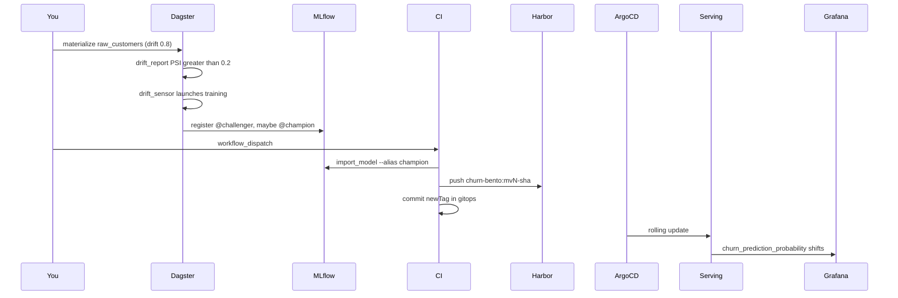

# M11: Capstone — drift to deploy, then an incident

## 1. Problem to solve

Every component works in isolation. The question this platform exists to answer is:

> New data arrived. Did we retrain, beat the champion, ship a new image, and can we **see** it?

If any hop is broken, customers keep getting the old model and nobody notices. This module runs that loop once, then drops you into a Friday-evening incident that spans four components.



## 2. Foundations

Promotion is not deployment
:   Moving `@champion` in MLflow changes a pointer in the registry. The running pods still have the **old weights baked into the image**. Serving updates only when CI builds a new image and Argo CD syncs it.

GitOps closes the loop
:   CI never talks to the cluster. The cluster pulls the image whose tag is in Git. If CI writes the tag to the wrong file, Argo CD is "Synced" and "Healthy" — serving the previous version.

Observability is how you know
:   `/model_info` on the Bento service and the Grafana heatmap of `churn_prediction_probability` are the two independent checks that a new model actually landed.

PSI threshold
:   Population Stability Index. Rule of thumb: &lt; 0.1 stable, 0.1–0.2 moderate, **&gt; 0.2** significant. `PSI_ALERT = 0.2` in the Dagster asset. Set it to 2.0 and no amount of drift will ever retrain.

Incident order
:   Work **backwards from the symptom**. "Grafana didn't move" is not one bug — it can be drift never fired, training never promoted, CI never rebuilt, Argo CD never synced, or the dashboard query is wrong. Check each hop.

!!! abstract "YouTube keywords"
    `mlops champion challenger`, `gitops rollback git revert`, `incident response production ml`, `psi population stability index`

## 3. Build it step by step

No new components. You operate what you already built.

### Step 1: Snapshot the current champion

```bash
# MLflow UI: http://mlflow.<SERVER_IP>.nip.io:8080  → Models → churn-classifier
# Note @champion version, e.g. v7

curl -s http://churn.$SERVER_IP.nip.io:8080/model_info | python -m json.tool
# "mlflow_version": "7"
```

### Step 2: Inject drift

Dagster UI (`http://dagster.<SERVER_IP>.nip.io:8080`) → `raw_customers` → Launchpad:

- Partition: a **new** day that does not yet exist (e.g. `2026-10-14`)
- Config:

```yaml
ops:
  raw_customers:
    config:
      n_customers: 10000
      drift: 0.8
      seed: 42
```

Launch, then materialize `clean_customers` and `drift_report` for that partition (or the ingest job). You should see `max_psi` well above 0.2 in the run metadata.

The `drift_sensor` (every 30 s) should request `training`. Watch Runs.

### Step 3: Promotion

When `churn_model` and `champion_model` succeed, MLflow `@champion` should move if the new AUC wins on the newest day. If it does **not** promote, that is a valid outcome (challenger lost) — bump `drift` or check the holdout.

```bash title="reference/m11/scripts/capstone.sh"
--8<-- "reference/m11/scripts/capstone.sh"
```

### Step 4: Trigger a release

Promotion does not deploy. In Gitea: **Actions → ci → Run workflow** (`workflow_dispatch`).

CI will:

1. `import_model --alias champion`
2. build `churn-bento:mvN-<sha>`
3. commit `newTag: mvN-<sha> # ci:churn-tag` under `platform/gitops/`
4. Argo CD rolls `serving/churn`

```bash
kubectl -n serving rollout status deploy/churn
curl -s http://churn.$SERVER_IP.nip.io:8080/model_info
```

The `mlflow_version` must be the new champion. Grafana **Churn API** heatmap should shift after you send a few `/predict` batches.

### Step 5: Rollback drill

```bash
git log --oneline platform/gitops/serving/kustomization.yaml | head
# revert the tag-bump commit (CI used [skip ci], so this won't retrigger a build)
git revert <deploy-commit> && git push gitea main
kubectl -n serving rollout status deploy/churn
```

`/model_info` is the old version again. Rollback is Git, not `kubectl rollout undo` (Argo CD would fight you).

```bash
git tag m11-done
```

## 4. Tweak and observe

1. **Promote but don't trigger CI.** Champion moves; pods stay on the old image. This is the most common "we trained it, production didn't change" report.
2. **Trigger CI without promotion.** CI bakes whatever `@champion` currently is — maybe the same version with a new SHA tag. Serving rolls, Grafana does not shift. Image tag ≠ model version.
3. **Manual `kubectl set image`.** Argo CD `selfHeal` reverts it in about a minute. Git wins.
4. **Sensor cursor.** Re-materialize the same drift partition: the sensor must **not** launch a second training run (`run_key` + cursor).

## 5. Break and fix — Friday incident

Four independent faults were found in the same hour. Fix each file in `exercises/m11/`, then:

```bash
make check-m11
```

**Incident report**

> 16:40 — marketing launched a campaign. We generated a drifted snapshot (`drift: 0.8`).
> 16:45 — no training run appeared.
> 17:10 — someone trained by hand and `@champion` moved to v12.
> 17:25 — CI is green. Serving `/model_info` still says v7.
> 17:40 — after a manual tag bump, Grafana still looks like v7.

Work backwards.

**bug01-psi-threshold** (`assets.py`). Symptom: `drift_report` has `max_psi ≈ 0.6` and the sensor never fires.

??? success "Solution"
    `PSI_ALERT = 2.0` is unreachable (PSI is rarely above 1). Restore `0.2`. The sensor compares `max_psi > PSI_ALERT`.

**bug02-ci-wrong-path** (`ci.yaml`). Symptom: CI commits, Argo CD is Synced, image on the cluster is unchanged.

??? success "Solution"
    The `sed` writes `newTag` in `platform/k8s/serving/churn.yaml` (the M6 hand-applied file). Argo CD watches `platform/gitops/serving/kustomization.yaml`. Fix the path and keep the `# ci:churn-tag` marker.

**bug03-argocd-manual** (`app.yaml`). Symptom: Git has the new tag, the cluster does not. The Application is `OutOfSync` and stays there.

??? success "Solution"
    `syncPolicy.automated` is missing, so Argo CD only reports drift. Add `automated: {prune: true, selfHeal: true}`. Self-heal is what reverts panic `kubectl edit`s.

**bug04-dashboard-metric** (`churn.json`). Symptom: the new model is live (`/model_info` matches), the heatmap is empty.

??? success "Solution"
    The panel queries `churn_score_bucket` — a name we never exported. The histogram is `churn_prediction_probability_bucket`. Confirm names on the Prometheus **Graph** page before editing Grafana.

## 6. Gotchas and best practices

- **Registry alias ≠ serving.** Always check `/model_info` after a "promotion".
- **Two sources of truth that must agree:** MLflow `@champion` and the image tag in Git.
- **Rollback = `git revert`**, then wait for Argo CD. `kubectl rollout undo` is undone by self-heal.
- **PSI thresholds belong in code review**, not in a one-off Launchpad click, or tomorrow's drift is silent.
- **CI `paths-ignore` + `[skip ci]`** on the tag-bump commit: without both, you loop.
- **Dashboards query metric names, not wishes.** Copy from `/metrics`.
- **Work backwards from the symptom** along the sequence diagram. Skipping hops wastes the evening.
